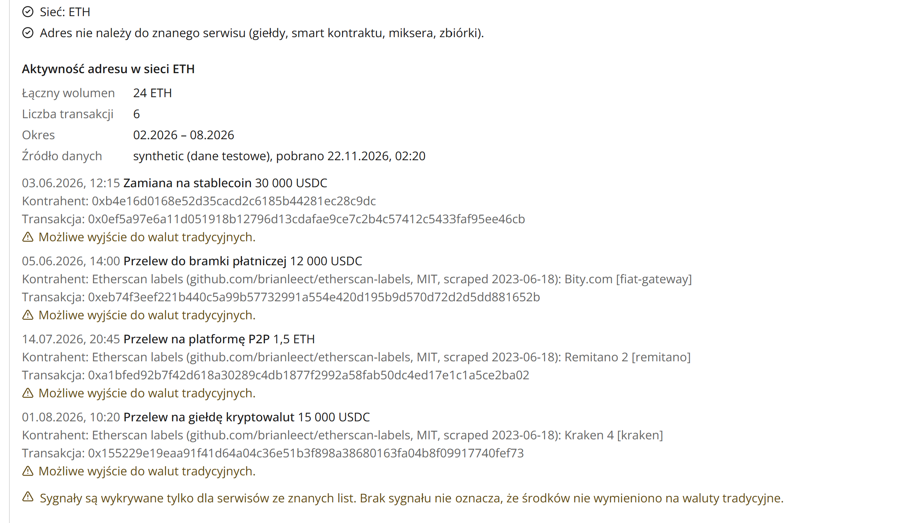

# Address Activity readability — Phase 2

Status: scoped implementation task only. Baseline master: `07a01f87f18fc0a067879d88e9ecb49daf7a5721`, checked 2026-11-22. The user requested a Phase 2 frontend readability improvement. No application implementation or deployment is part of publishing this specification.

## Reference and problem

[User-provided current view](reference-current.png)

The current block puts summary figures, event titles, full hashes, label-dataset provenance and repeated cash-out warnings at similar visual weight. Long strings hide the useful date/type/amount and produce excessive wrapping on small screens.

Existing implementation: `frontend/apps/web/features/analysis-report/attribution-details.tsx` (`Activity`) and `address-activity-figures.ts`. The latter currently flattens `counterpartyLabel ?? counterpartyAddress` into one string, although the generated DTO has both. The label itself can contain dataset provenance, not just an entity name. The fields already available are sufficient for a useful FE-only minimum.

## Proposed presentation

1. Compact summary with volume, transaction count and covered period; preserve existing units/calculation semantics. Keep data source, collection time and a clearly visible `Dane testowe` marker next to it. Do not sum ETH and USDC or infer total activity from the number of displayed signals.
2. A section titled `Sygnały możliwego wyjścia do walut tradycyjnych`, chronological ascending as today, labelled with the displayed signal count. These are selected indicators, not the entire transaction history.
3. Each event is a distinct compact row/card: date/time, existing type and amount/unit. Visual hierarchy and whitespace separate events. Do not add a chart, new metric or another navigation level.
4. Expandable details retain counterparty address/label, transaction id, source/provenance and any event-specific limitations already supplied. Shorten hashes only for presentation; provide the full value and an accessible copy action. Copy the exact original value; show success only on successful clipboard write and handle failure.
5. Use a readable entity name only when supplied as a separate reliable field. Never use ad-hoc regex to claim that an opaque provenance string is a verified entity name. For the FE-only minimum, put the complete opaque label under `Dane kontrahenta` / details; the readable event type remains the primary line. If a dedicated displayName/classificationSource contract is genuinely needed, document and agree a small separate BE follow-up rather than guessing ownership or changing saved evidence.
6. Use only backend-provided http(s) transaction URLs. Do not construct explorer URLs from synthetic hashes or automatically turn counterparties into inferred entities. Long values must wrap without horizontal page overflow.
7. Explain cash-out uncertainty once at the section level; avoid the same generic warning after every event. Keep all distinct event-specific and coverage limitations, especially incomplete/partial explorer answers. No zero-state text may claim that the person did not cash out.
8. Preserve AVAILABLE/UNAVAILABLE/NOT_CHECKED, real zero, unknown/null and available totals with a missing transaction list. A zero signal count and zero transaction count are different. Do not hide synthetic state when details are collapsed.

## Scope and boundaries

Reuse existing report components/design tokens, generated DTOs and pure view-model seam. No new service/library, graph, explorer request, blockchain rule or confidence calculation. Do not weaken the distinction between an observed transaction, a computed summary and an interpretation. Nearby address classification is not rewritten by this readability task.

Frontend rules and ADR-0010 apply: Vitest for pure mapping/formatting invariants; real browser verification for components/clipboard/links/focus, without adding component/E2E test infrastructure. Any necessary API change follows api-contract and is explicit rather than silently hand-editing generated code.

## Acceptance / verification

- On the supplied synthetic example, the Analyst can scan summary and four signals without full hashes or repeated generic warnings in the compact view.
- Every event expands to the same complete underlying data; transaction identity, counterparty data, provenance and limitations remain recoverable.
- Test copy actions, approved URL/no-URL handling, repeated transaction ids across distinct signals, missing dates/amounts, long opaque labels, units and stable chronology.
- Test missing data vs genuine zero, no signals, many signals and partial explorer answers. No synthetic link is invented and no score/event amount is changed.
- Verify desktop and small screen, keyboard expansion and copy focus, accessible labels, contrast and no console errors. Supply before/after screenshots on equivalent viewports in the implementation PR.
- Run repository FE checks/build; keep existing report/summary tests passing. Record the exact SHA/environment checked.

Related: #11 (Attribution details/report), #23 (implemented E4), #79 (partial explorer answers). This is a narrow presentation follow-up, not a duplicate of their domain implementation. Phase P2, estimated M with medium confidence; main integration risk is accidental loss of evidence or null/zero semantics while simplifying the view.
