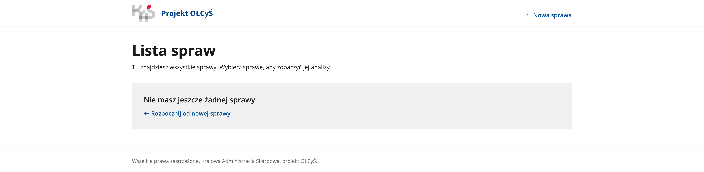
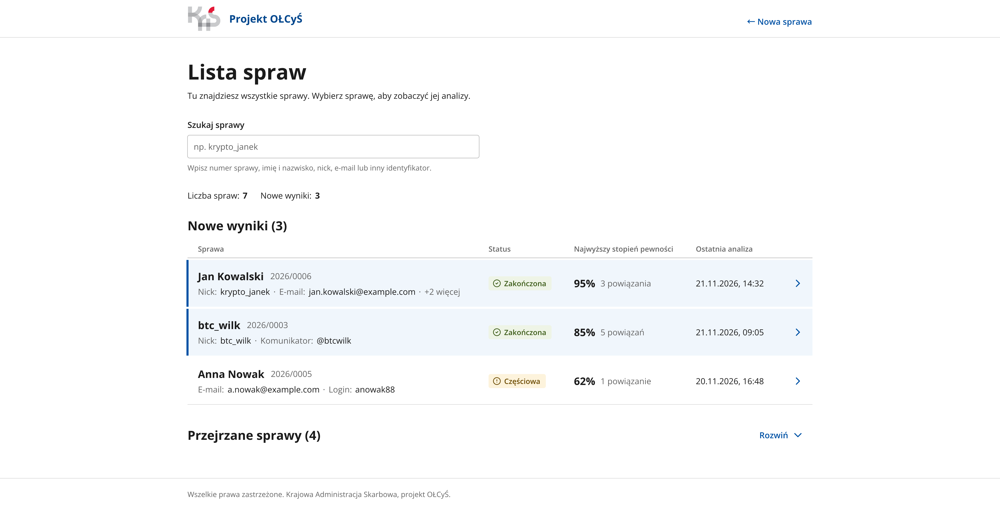
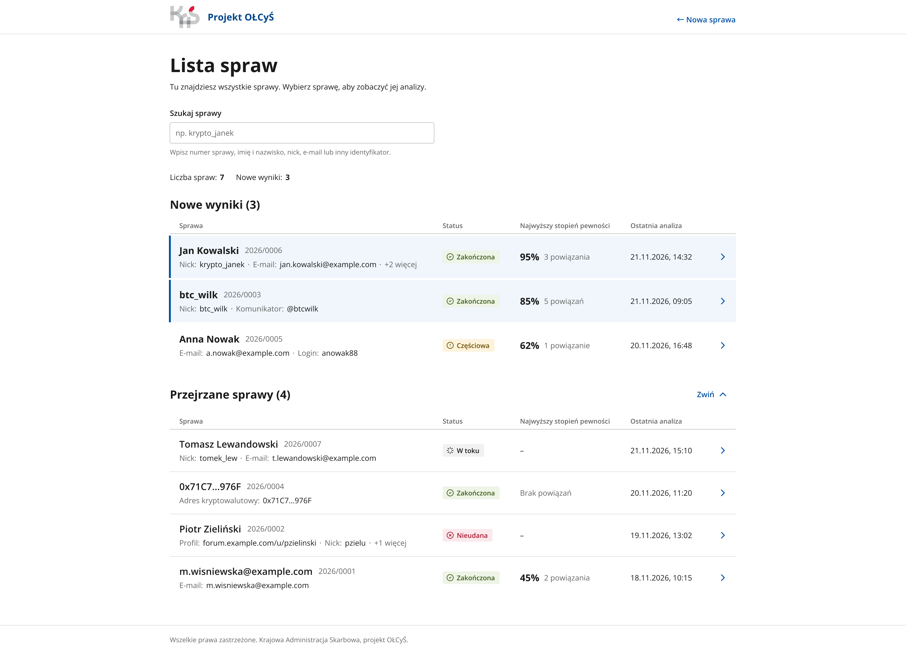
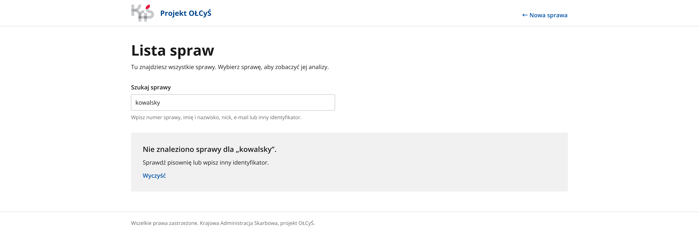

# Case list — implementation specification

Status: implementation backlog, no application code changed. Evidence baseline: `master` `8e92524fbe40eed7f6b090683223733a6bdfbbbf`, checked 2026-11-22. Four states of one `/cases` screen, not four separate routes.

## Scope and decisions

The user requested implementation tasks and a shared specification, not implementation or deployment. The user explicitly chose browser-local Reviewed state on 2026-11-22: keep the existing explicit button and `localStorage`, extend the mark with the reviewed Analysis identity. No review endpoint, shared server flag, login or user accounts.

Existing sources of truth: [views](https://github.com/NononotaaSquad/cryptofoot/blob/8e92524fbe40eed7f6b090683223733a6bdfbbbf/.agents/context/frontend/views.md), [existing report specification Q4](https://github.com/NononotaaSquad/cryptofoot/blob/8e92524fbe40eed7f6b090683223733a6bdfbbbf/.agents/specs/2026-11-21_analysis-report/spec.md), [frontend rules](https://github.com/NononotaaSquad/cryptofoot/blob/8e92524fbe40eed7f6b090683223733a6bdfbbbf/.agents/rules/frontend.md), [test scope ADR](https://github.com/NononotaaSquad/cryptofoot/blob/8e92524fbe40eed7f6b090683223733a6bdfbbbf/.agents/context/frontend/decisions/0010-test-scope.md).

`views.md` V11 proposed server persistence, but Q4 later implemented browser storage and the user explicitly reconfirmed that scope. Update the conflicting documentation during implementation; do not implement V11's server flag. Opening a report alone never marks it Reviewed. A failed terminal Analysis is a new result too, so the Analyst learns that the check failed.

## Shared visual references

Original user-provided PNGs are committed beside this document, available to every repository reader:

1. [No Cases](assets/01-no-cases.png)
2. [Results, Reviewed collapsed](assets/02-reviewed-collapsed.png)
3. [Results, Reviewed expanded](assets/03-reviewed-expanded.png)
4. [No search matches](assets/04-no-search-matches.png)

Editable design: [Pencil source](https://github.com/NononotaaSquad/cryptofoot/blob/8e92524fbe40eed7f6b090683223733a6bdfbbbf/.agents/context/frontend/2026-11-21_kas-olcys-views_v01.pen). Relevant frames: `[MAIN] Lista spraw`, `[STAN] Lista spraw – brak spraw`, `[STAN] Lista spraw – przejrzane rozwinięte`, `[STAN] Lista spraw – brak wyników wyszukiwania`. Reference images have different canvas sizes; compare layout at the equivalent viewport/scale, not literal exported PNG pixel sizes.

Reuse PageShell, existing KAS logo, Open Sans, palette and components. Design content column: centred 1200 px at a 1920 px viewport. New Results rows have bold labels. A blue left bar and light blue background mean **highest Confidence Level >=80**, not unread, hover, focus or selection. Hover/focus still need accessible states. Use Polish user-facing copy; code and documentation follow repository conventions.

## Current implementation and gap map

| View data/behaviour | Existing source | Necessary change |
| --- | --- | --- |
| Route/layout | `frontend/apps/web/app/cases/page.tsx`, PageShell | Replace heading-only stub with a feature view; preserve shell |
| Case list and identifiers | `GET /api/1/cases`, `CaseResponse.id/identifiers/createdAt/latestAnalysis` | Reuse full unpaginated list; no new search endpoint at this scale |
| Label / two identifiers | `lib/identifiers/identifier-kinds.ts` | Reuse `caseLabel`, narrowing identifier order and labels; only presentation/truncation |
| Case Number | missing in DTO/storage | Existing **#56** owns numbering, concurrency and old-record assignment; no duplicate numbering issue |
| Latest status/date/id | `CaseResponse.latestAnalysis` | Reuse; status, date, maximum and count must describe the same latest snapshot |
| Attribution count | `AnalysisResponse.attributionCount` | Reuse semantics: size of `result.attributions`, including zero-confidence leads; exclusions/rejected candidates never counted |
| Highest confidence | absent from `AnalysisResponse` | Add nullable `highestConfidenceLevel`, computed from the same saved attributions without rescoring |
| Finished result while latest is RUNNING | latest-only response is insufficient | Add nullable `CaseResponse.latestFinishedAnalysis` using existing AnalysisResponse shape, newest terminal Analysis by startedAt then id |
| Reviewed | case-local timestamp in `features/case-details/reviewed-store.ts` | Versioned mark containing the exact Analysis id/order; shared store used by list/details/counter |
| History / report opening | existing Case details and `?analysis=` routing, #13 | Reuse; no new history/report engine |
| Comparison | BE #26; FE PR #81 open when checked | Related only; list tasks do not duplicate/modify comparison |
| Search | absent | Filter all Cases returned by the existing unpaginated list in FE |
| Counters, grouping, refresh | absent | Derived from list + browser mark; background refetch preserves UI state |

Evidence: [CaseService](https://github.com/NononotaaSquad/cryptofoot/blob/8e92524fbe40eed7f6b090683223733a6bdfbbbf/backend/src/main/kotlin/squad/nononotaa/backend/service/CaseService.kt), [AnalysisHistoryService](https://github.com/NononotaaSquad/cryptofoot/blob/8e92524fbe40eed7f6b090683223733a6bdfbbbf/backend/src/main/kotlin/squad/nononotaa/backend/service/AnalysisHistoryService.kt), [DTOs](https://github.com/NononotaaSquad/cryptofoot/blob/8e92524fbe40eed7f6b090683223733a6bdfbbbf/backend/src/main/kotlin/squad/nononotaa/backend/dto/Responses.kt), [reviewed-store](https://github.com/NononotaaSquad/cryptofoot/blob/8e92524fbe40eed7f6b090683223733a6bdfbbbf/frontend/apps/web/features/case-details/reviewed-store.ts), [CaseHeader](https://github.com/NononotaaSquad/cryptofoot/blob/8e92524fbe40eed7f6b090683223733a6bdfbbbf/frontend/apps/web/features/case-details/case-header.tsx).

## Snapshot and API rules

Keep `latestAnalysis` ordered by startedAt descending, then id descending (the current BE order). `latestFinishedAnalysis` uses the same order restricted to COMPLETED/PARTIAL/FAILED. It is null before any Analysis finishes. It includes failures, not only successful results. If latest is terminal, both fields identify the same Analysis. Do not return a history array or full reports per list row.

`AnalysisResponse.highestConfidenceLevel: Int?` is additive and computed at read time from the persisted `result.attributions[].confidenceLevel`. Empty/no result -> null. All zero-confidence leads -> 0, not null. Keep `attributionCount` unchanged; this screen lists verification leads, never confirmed ownership. `attributionCount=0` + finished successful result -> `Brak powiązań`. Positive count and maximum 0 -> `0%` + count, without blue highlight. A positive count with an unavailable maximum is unknown, not zero. Legacy missing/partial data must retain null and not be silently rescored by the current algorithm.

RUNNING and FAILED rows show `–` for confidence/count presentation even if raw saved diagnostics exist. A null latest Analysis shows `Bez analizy`, `–`, `–`. For terminal analyses use finishedAt (fallback startedAt); RUNNING uses startedAt. Dates use Intl `pl-PL` and Europe/Warsaw explicitly, consistent with nearby views; do not guess browser timezone.

The row's status/date/confidence always describe `latestAnalysis`. While it is RUNNING, the row opens `latestFinishedAnalysis` via `/cases/{id}?analysis={finishedId}` if available; otherwise opens the running Analysis, or the Case without a query when none exists. This deliberate navigation fallback must not leak the previous score into the RUNNING row. For other states open latestAnalysis explicitly; without one open Case details' existing empty state.

No search pagination is added: existing `GET /cases` returns the whole list. If implementation discovers a newly paginated API, revise the task before pretending a single page is the full result. Backend reading may reuse existing repositories; avoid full report HTTP requests from FE per row. No new persisted score field or rewrite of historical Analysis documents is required. Use normal OpenAPI generation and generated Orval hooks; never hand-edit generated files.

## Browser-local Reviewed state

Keep the explicit `Oznacz jako przejrzaną` / `Cofnij oznaczenie` actions. Store a versioned record with the exact reviewed Analysis id and its order key (startedAt/id), optionally reviewedAt for diagnostics. Mark only the terminal Analysis actually displayed; do not mark the newest in a later refetch. A stale button/click for A followed by completion of B must leave B new. Opening or polling, including automatic arrival of a scheduled result, makes no write. Viewing an older Analysis never marks a newer one. Do not move an existing newer reviewed watermark backwards when an older report is marked. Undo removes the watermark for that Case only.

`hasNewResults = latestFinishedAnalysis exists and is newer than the valid Reviewed watermark` (unmarked/missing/malformed watermark -> new). FAILED is terminal/new; RUNNING by itself is not. While a new run is in progress, preserve whether the latest finished result is new or reviewed. Case without a finished run belongs to the non-new presentation bucket, not a persisted Reviewed state. The mock's `Przejrzane sprawy` group is the non-new bucket; its `W toku`/`Bez analizy` rows must not falsely show `Sprawa przejrzana` in Case details. No third group is introduced in this minimum; document this edge-case meaning explicitly.

Legacy values currently contain only an ISO timestamp and cannot reliably identify a reviewed Analysis. Preserve the legacy value but do not treat it as a mark for every future result; conservatively require one explicit mark in the versioned model. Malformed/unavailable storage is unreviewed. Keep the app usable when storage is blocked/full and do not show a successful persisted mark if saving failed. The user accepts per-browser scope, not shared state across devices. Subscribe to same-tab changes and cross-tab storage events; keep server/hydration snapshots stable.

Extract pure derivation/serialization/comparison helpers for Vitest; verify browser storage/hook/component interactions in the running browser, following ADR-0010. No new component or automated E2E framework.

## List, groups and search

Label: existing `caseLabel`: fullName, otherwise first available narrowing identifier in order nickname, login, email, messengerId, profileUrl, walletAddress. Show at most two narrowing identifiers in that order; `+N więcej` is the count of the rest. Full name is the title, not an extra narrowing identifier. Truncate long wallet/profile presentation accessibly; use complete strings for search and the existing details view. Do not make an expandable button inside a whole-row link: expose the full identifiers on Case details.

Use Case Number from #56 when returned; before it is available hide it, never manufacture a number from id/index. Number search is available only for real returned numbers. Full four-reference acceptance requires #56.

Filter as the Analyst types, no Search submit button. Trim query; case-insensitive substring matching over Case Number, fullName and every full identifier. Do not make `kowalsky` match `Kowalski` by fuzzy inference. Use literal matching, not a user-built regex. Clearing restores all Cases and retains focus in the search field. A query never creates a Case or Analysis.

Group after filtering. Both statistics and section counts refer to matching Cases; New Results counts Cases, not Analyses. Keep the same semantics for the global navigation badge except it is unfiltered. New Results: descending known highest confidence of latestAnalysis; unknown values last; then latest date descending and id for stable tie-breaking. Reviewed/non-new: latest date descending, Case.createdAt fallback when no Analysis, then id. Sections with zero matches are hidden. The non-new section is collapsed by default. For a non-empty search with matches in it, expand it automatically; on clearing restore the user's pre-search expansion choice. Background refresh must preserve query/expansion and focus.

No Cases: hide search, show `Nie masz jeszcze żadnej sprawy.` and `← Rozpocznij od nowej sprawy`. No matches: keep search and show `Nie znaleziono sprawy dla „{trimmed query}”.`, `Sprawdź pisownię lub wpisz inny identyfikator.`, `Wyczyść`. Escape/markup in the query is rendered as text. Initial request error is the shared error UI, not an empty-state message; retry keeps the query. A failed background refresh keeps existing rows and shows a non-blocking error without turning stale values into zero/new state.

Use one shared generated TanStack query/key for the list and global New Results badge, not N report calls. While the screen is visible, refetch every 10 s (including when no current run is visible, because a scheduled run may start); pause interval in hidden tabs, refetch on focus. Refetch/invalidate after known starts/completions and review changes; no fetch is needed for a local-only mark. Polling never starts analyses or rewrites history. Timers belong to data fetching, not a second scheduler. Integrate the badge in existing `Lista spraw` links without replacing PageShell or breaking Case details' pinned report and PR #81.

## Acceptance and test plan

Backend Spock: no Cases; no Analysis; RUNNING only; terminal + newer RUNNING; all terminal statuses; count=0; zero maximum with positive count; exclusions/rejections excluded; multiple scores; deterministic tie; legacy records; latest and latestFinished identity; reads do not rerun or mutate snapshots. API-sync and generated client must pass CI.

Frontend Vitest for pure invariants: label/identifier overflow, status/null/zero presentation, same-snapshot summary, 79/80 highlight, sort stability, trim/case/full-address/number search, grouped counts, mark ordering, A/B completion race, undo and conservative legacy parsing. Follow frontend rules: no new automated component/E2E tests.

Browser walkthrough with a real local backend and controlled synthetic data: no Cases -> states A; several Cases -> B/C; all statuses and no Analysis; matching search auto-expands Reviewed; unmatched `kowalsky` -> D -> Clear; explicit mark/undo; reload and second tab; open older report and complete a newer manual/scheduled run; new result returns to top without replacing the report being read; API error/retry; background error; keyboard focus; long identifiers; no console errors. Compare desktop reference layout at an equivalent viewport and verify a small viewport without clipped content. Save a brief verification record and captured screenshots in the implementing PR. Do not reset/delete shared demo data; use a dedicated test database.

## Boundaries and delivery order

Existing #56 owns Case Numbers. Existing #13 owns history/report reopening, already substantially implemented. #14/PR #81 owns comparison. #15/#27/#78 own the implemented scheduler. Do not reopen/rewrite those features as list tasks.

Delivery tasks: BE summary; browser mark upgrade; FE rows/layout; search/grouping/live counters; integration/visual verification. BE summary and browser mark work may proceed in parallel; layout can use typed synthetic fixtures in tests while waiting, but production must use the generated client. Search/grouping depends on those contracts/store; final verification depends on all and #56. Coordinate DTO generation and shared files rather than creating independent conflicting contracts. No assignee is inferred from old module ownership.

Out of scope: server review persistence/auth, editing/deleting Cases, new comparison engine, scheduler rewrite, new scoring algorithm, external sources, export, new database, committed automated E2E framework. Application implementation remains for a separate user instruction.
