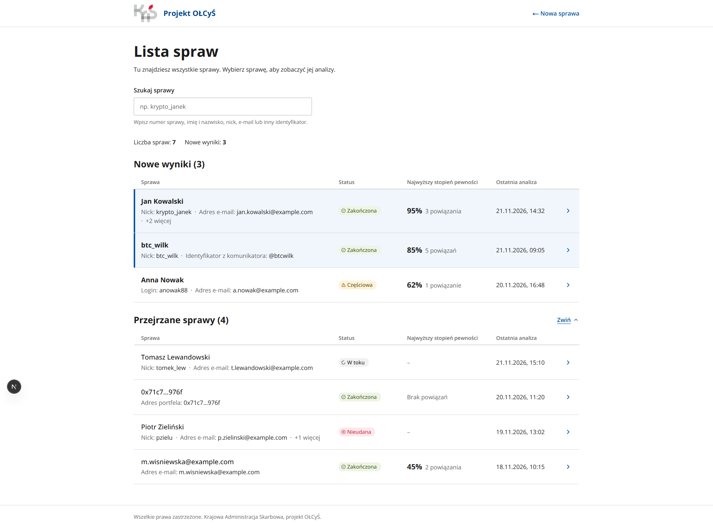
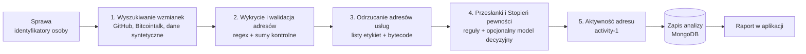
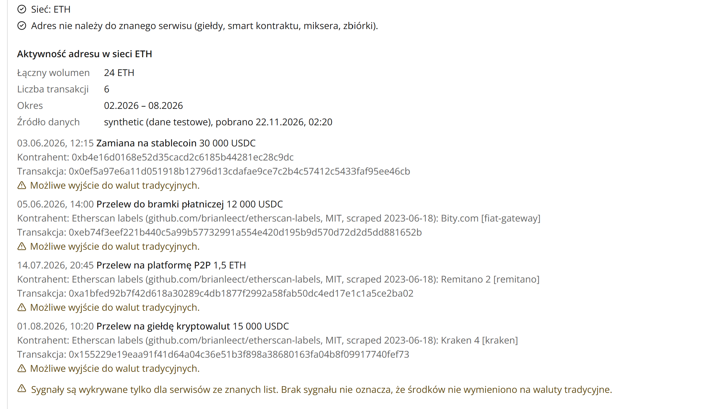
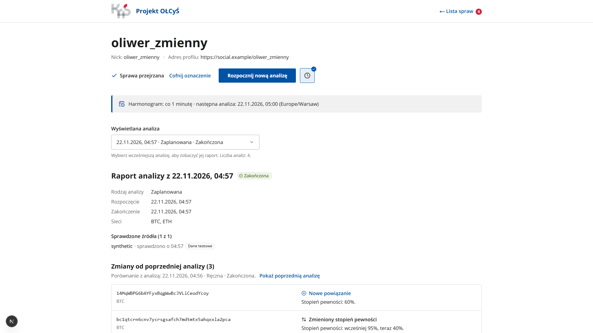

# cryptofoot (OŁCyŚ)

Narzędzie OSINT dla analityków Krajowej Administracji Skarbowej. Analityk wpisuje identyfikatory osoby (nick, login, e-mail, ID z komunikatora, adres profilu, adres portfela). Aplikacja przeszukuje publiczne źródła, wyodrębnia i weryfikuje adresy kryptowalutowe, odrzuca adresy giełd, smart kontraktów, mikserów i zbiórek, a każdemu pozostałemu adresowi wylicza **Stopień pewności** (0–100%) z jawną punktacją. Punkty przyznają stałe reguły na podstawie przesłanek. Opcjonalny **model decyzyjny** pomaga odczytać, co tekst mówi o adresie: czy to własna deklaracja, ogłoszenie, dyskusja, czy ostrzeżenie. Dla adresów z niezerowym Stopniem pewności odczytuje też **aktywność w sieci** (BTC, ETH) i **sygnały wyjścia do walut tradycyjnych**. Każda analiza jest zapisywana z pełnymi metadanymi, można ją powtarzać ręcznie lub cyklicznie i porównywać z poprzednią.

Zadanie konkursowe Ministerstwa Finansów na HackNation 2026 („Jak identyfikować i oceniać powiązania pomiędzy cyfrowymi śladami a adresami krypto”).

> [!IMPORTANT]
> Wynik narzędzia to **trop do dalszej weryfikacji, a nie dowód**. Powiązanie nie przesądza, że adres należy do osoby, a sygnał wyjścia do walut tradycyjnych nie jest dowodem wypłaty ani naruszenia przepisów podatkowych. Aplikacja mówi to wprost w raporcie.



## Spis treści

- [Problem i rozwiązanie](#problem-i-rozwiązanie)
- [Jak działa analiza](#jak-działa-analiza)
- [Stopień pewności i model decyzyjny](#stopień-pewności-i-model-decyzyjny)
- [Odrzucanie błędnych przypisań](#odrzucanie-błędnych-przypisań)
- [Aktywność adresu i sygnały wyjścia do walut tradycyjnych](#aktywność-adresu-i-sygnały-wyjścia-do-walut-tradycyjnych)
- [Raport dla analityka](#raport-dla-analityka)
- [Analizy cykliczne i porównywanie wyników](#analizy-cykliczne-i-porównywanie-wyników)
- [Parametry wyszukiwania](#parametry-wyszukiwania)
- [Założenia projektu](#założenia-projektu)
- [Scenariusze testowe na danych syntetycznych](#scenariusze-testowe-na-danych-syntetycznych)
- [Uruchomienie](#uruchomienie)
- [Testy](#testy)
- [Architektura i technologie](#architektura-i-technologie)
- [Bezpieczeństwo i zgodność z zasadami OSINT](#bezpieczeństwo-i-zgodność-z-zasadami-osint)
- [Znane ograniczenia i dalszy rozwój](#znane-ograniczenia-i-dalszy-rozwój)
- [Licencje komponentów](#licencje-komponentów)

## Problem i rozwiązanie

Pracownik KAS, który szuka adresów kryptowalutowych badanej osoby, dziś ręcznie przegląda fora, profile i ogłoszenia, a potem sam łączy znaleziska i ocenia, na ile są wiarygodne. Przy szerszej analizie zajmuje to dużo czasu, jest trudne do powtórzenia i generuje wiele fałszywych tropów.

OŁCyŚ automatyzuje ten proces i oddziela od siebie dwie role: **„agent w terenie nie ocenia, analityk przy biurku nie szuka”**.

| Moduł | Pytanie | Wynik |
| --- | --- | --- |
| Dane wejściowe | Kogo badamy? | Sprawa z identyfikatorami osoby |
| Wyszukiwanie | Co znaleziono i gdzie? | Wzmianki ze źródłem, adresem URL, czasem pobrania i cytatem |
| Ocena: czyj adres | Czy to adres tej osoby? | Powiązania ze Stopniem pewności, Punktacją i Uzasadnieniem; Adresy wykluczone i odrzucone |
| Ocena: co robił adres | Czy za adresem stoją realne pieniądze? | Aktywność adresu i sygnały wyjścia do walut tradycyjnych w kolejności czasowej |
| Widok urzędnika | Co z tego wynika i skąd to wiemy? | Raport w aplikacji: rozwijana lista Powiązań, historia i porównanie analiz |

Główna zasada projektowa to **mało szumu**: nie pokazujemy informacji, które zwiększają liczbę fałszywych tropów do sprawdzenia. Interfejs jest po polsku i nie używa żargonu technicznego.

## Jak działa analiza

Jedna analiza to pięć etapów. Każdy etap to osobny moduł za interfejsem (portem), a orkiestrator nie zawiera logiki wyszukiwania ani oceny, tylko wyznacza status analizy.



1. **Wyszukiwanie** (`SearchService`) odpytuje wszystkie włączone źródła równolegle (wirtualne wątki, limit czasu na źródło). Zachowuje tylko trafne wzmianki i zapisuje każdą z pełną treścią, 200-znakowym fragmentem dla analityka i identyfikatorem SHA-256 (źródło + URL + treść).
2. **Przygotowanie kandydatów** (`CandidatePreparationService`, `AddressValidator`) waliduje ciągi wykryte w całej treści wzmianki i sprowadza adresy do postaci kanonicznej. Ten sam adres z wielu wzmianek staje się jednym kandydatem.
3. **Klasyfikacja wykluczeń** (`ExclusionClassifierService`) dzieli kandydatów na przyjętych, wykluczonych (z powodem i źródłem klasyfikacji) i niesklasyfikowanych.
4. **Ocena** dzieli wzmianki na przesłanki. Gdy model jest włączony, `ModelPremiseAssessment` pyta go o każdą przesłankę przyjętych i niesklasyfikowanych adresów (adresy odrzucone i wykluczone nigdy nie trafiają do modelu). Potem `ConfidenceScoringService` liczy punkty. To czysta funkcja: te same oceny przesłanek zawsze dają ten sam Stopień pewności, te same reguły i ten sam tekst Uzasadnienia.
5. **Aktywność adresu** (`AddressActivityService`) sprawdza tylko Powiązania z wynikiem powyżej 0%.

Status analizy:

| Status | Kiedy |
| --- | --- |
| `Zakończona` | Wszystkie etapy przeszły, nic nie było niedostępne. Zero wzmianek ze sprawnych źródeł to też `Zakończona` („brak wyników” nie jest błędem). |
| `Częściowa` | Część źródeł, klasyfikacji lub danych z sieci była niedostępna. Reszta wyniku zostaje zachowana i oznaczona Ograniczeniami raportu. |
| `Nieudana` | Nie da się uzyskać żadnego użytecznego wyniku (wszystkie źródła niedostępne albo awaria modułu). Zapisywana w historii, nigdy nie jest pokazywana jako analiza bez znalezisk. |

Zakończona analiza nigdy się nie zmienia. Ponowne uruchomienie tworzy nową analizę, a otwarcie raportu tylko odczytuje zapisany wynik.

## Stopień pewności i model decyzyjny

Stopień pewności liczą **stałe, jawne reguły** na podstawie **przesłanek**. Model decyzyjny może pomóc odczytać, co tekst mówi o adresie. Nie przyznaje jednak punktów, nie łączy adresu z osobą i nie pisze Uzasadnienia.

| Wersja algorytmu | Tryb oceny | Kiedy działa |
| --- | --- | --- |
| `confidence-2` | tylko reguły | Brak klucza API modelu albo model wyłączony. Nic nie jest wysyłane do modelu. |
| `confidence-3` | reguły z modelem | Ustawiony `ASSESSMENT_MODEL_API_KEY` |

Wersja algorytmu, tryb oceny, wersja modelu i wersja zestawu pytań są zapisywane z każdą analizą. Analizy zapisane wcześniej zachowują swoją wersję, np. `confidence-1`, pierwszą wersję opartą tylko na słowach kluczowych.

### Przesłanka i fakty liczone przez kod

Przesłanka to jedno wystąpienie adresu we wzmiance. Adresy są wykrywane w całej treści wzmianki, a każda przesłanka dostaje okno tekstu do 1200 znaków (do 600 przed adresem i za nim). Kod wylicza dla niej fakty:
- czy autor wpisu to badana osoba (porównanie z nickiem lub loginem: tak, nie, nieznany);
- czy wpis leży pod adresem profilu ze sprawy;
- które identyfikatory osoby są w oknie i jak daleko od adresu;
- czy w tekście jest e-mail innej osoby, ile adresów zawiera wpis i z jakiego serwisu pochodzi.

**Powiązanie z osobą ustala wyłącznie kod.** Przesłanka łączy adres z osobą w trzech przypadkach:
- autorem jest badana osoba;
- wpis leży pod adresem jej profilu, a autor nie jest kimś innym;
- identyfikator zawężający stoi najwyżej 200 znaków od adresu. Imię i nazwisko oraz wpisany portfel się tu nie liczą.

Identyfikatory są dopasowywane jako całe słowa, więc nick `max` nie pasuje do słowa „maximum”.

Każda przesłanka ma jeden status:

| Status | Znaczenie |
| --- | --- |
| Zaliczona | Liczy się do punktów |
| Do weryfikacji | Wymaga oceny analityka; liczy się najwyżej jak dyskusja (40 pkt) |
| Odrzucona | Nie daje punktów. Powód: brak powiązania z osobą, e-mail innej osoby, ostrzeżenie przed adresem albo adres podany jako własny przez inną osobę. |

**Tylko reguły (`confidence-2`).** Kolejne sprawdzenia:
- brak powiązania z osobą: przesłanka odrzucona;
- e-mail innej osoby: odrzucona;
- słowo ostrzeżenia w zdaniu z adresem („oszust”, „scam”, „podszywa się”, „nie wpłacaj”, „phishing” itp.): do weryfikacji, 0 pkt;
- w pozostałych przypadkach rodzaj wpisu wynika ze słów kluczowych.

**Z modelem (`confidence-3`).** Model odpowiada prawdopodobieństwami na trzy pytania zestawu `premise-questions-1`:
1. **Rodzaj wpisu**: własna deklaracja, sprzedaż lub rozliczenie, dyskusja albo komentarz masowy.
2. **Deklaracja**: czy autor przedstawia oceniany adres jako swój.
3. **Ostrzeżenie**: czy tekst każe nie używać adresu albo mu nie ufać.

Progi są w kodzie. Prawdopodobieństwo co najmniej 0,7 to „tak”, najwyżej 0,3 to „nie”, wartości pomiędzy to „niepewne”. Rodzaj wpisu liczy się od 0,5. Na odpowiedzi modelu kod nakłada stałą tabelę:
- brak powiązania z osobą: odrzucona. Wyjątek: autor deklaruje adres jako swój, wtedy przesłanka trafia do weryfikacji;
- e-mail innej osoby: odrzucona (decyduje kod);
- ostrzeżenie bez deklaracji: odrzucona;
- deklaracja, ale autorem jest inna osoba: odrzucona jako adres podany przez inną osobę. Typowy przykład to komentarz obcego użytkownika na profilu badanej osoby;
- deklaracja i ostrzeżenie od badanej osoby (np. „to mój stary adres, nie wysyłajcie”): własna deklaracja z adnotacją „adres wycofany”;
- własny profil rozpoznaje kod, w pozostałych przypadkach rodzaj wpisu podaje model;
- niepewna odpowiedź, która mogłaby zmienić wynik: do weryfikacji, najwyżej 40 pkt.

Gdy model nie odpowie dla przesłanki (limit 5 s, bez ponowień), przesłankę oceniają same reguły, a raport dostaje Ograniczenie „Model nie ocenił części lub wszystkich przesłanek”.

### Punkty

| Rodzaj przesłanki | Jak rozpoznawany | Punkty |
| --- | --- | ---: |
| Własny profil osoby | URL pod adresem profilu ze sprawy albo strona nazwana nickiem lub loginem **i** drugi identyfikator (e-mail, ID komunikatora, imię i nazwisko). Sam nick może należeć do imiennika. | 80 |
| Własna deklaracja autora | Odpowiedź modelu (tylko `confidence-3`) | 80 |
| Ogłoszenie sprzedaży lub rozliczenie | Model albo słowa: ogłoszenie, sprzedam, kupię, oferta, P2P, płatność, zapłata, wpłata, przelew, rozliczenie, faktura | 60 |
| Dyskusja | Pozostałe przesłanki (forum, grupa tematyczna) | 40 |
| Komentarz masowy | Model albo słowa: giveaway, konkurs, rozdanie, airdrop, wygraj, promo | 10 |

- **Baza** to najsilniejsza zaliczona przesłanka.
- **Premia +15 pkt** (raz) wymaga dwóch zaliczonych przesłanek, każdej co najmniej na poziomie dyskusji, z **różnych serwisów**, w których **zdanie z adresem jest różne**. Komentarz masowy niczego nie potwierdza. Kolejne wzmianki z tego samego serwisu i skopiowana treść nie dają premii.
- **Limit 59%** dotyczy adresu, którego nie udało się sklasyfikować (może należeć do giełdy albo kontraktu). Taki adres nigdy nie wygląda na bardzo wysokie prawdopodobieństwo.
- **Reguły 0 pkt** wyjaśniają, dlaczego wynik nie jest wyższy: adres wpisany przez analityka (samo wpisanie nie jest dowodem), powiązanie tylko przez nick lub login, przesłanki do weryfikacji, ostrzeżenie, e-mail innej osoby, adres podany przez inną osobę, adres wycofany, skopiowana treść, ten sam serwis, ocena z pomocą modelu.

Każda reguła w Punktacji wskazuje przesłanki, które ją uruchomiły. Wynik to suma punktów, maksymalnie 100%. Przedziały w raporcie:

| Stopień pewności | Etykieta |
| --- | --- |
| 80–100% | Bardzo wysokie prawdopodobieństwo |
| 60–79% | Prawdopodobny |
| 40–59% | Średni |
| 0–39% | Niski / szum |
| – | Adres wykluczony (giełda, smart kontrakt, mikser, zbiórka): nie jest Powiązaniem |

### Przykład: scenariusz S1 (dane fikcyjne)

Analityk tworzy sprawę z nickiem `halka_eth`, e-mailem `halina.przykladowa@example.com` i adresem profilu `https://social.example/halka_eth`. Źródło danych syntetycznych zwraca dwie wzmianki z tym samym adresem ETH. Domeny `social.example` i `market.example` to zarezerwowane domeny testowe, a nie prawdziwe serwisy.

| Wzmianka | Treść (skrót) | Co z niej wynika |
| --- | --- | --- |
| `https://social.example/halka_eth` | „halka_eth – Halina Przykładowa. Tu publikuję mój portfel ETH: 0xE73A…20c6. Kontakt: halina.przykladowa@example.com” | Strona leży pod adresem profilu ze sprawy, więc to **własny profil**: 80 pkt |
| `https://market.example/oferta/451` | „halka_eth sprzedaje rower szosowy. Płatność w ETH na 0xE73A…20c6, pytania: halina.przykladowa@example.com” | **Ogłoszenie sprzedaży** z nickiem i e-mailem osoby obok adresu. To inny serwis i inne zdanie, więc **niezależne potwierdzenie**. |

Punkty się nie sumują. Bazą jest najsilniejsza przesłanka (profil, 80), a ogłoszenie daje tylko premię za drugie, niezależne źródło (+15):

| Reguła (Punktacja) | Punkty |
| --- | ---: |
| Adres na profilu osoby (social.example) | 80 |
| Potwierdzenie w niezależnych źródłach (market.example, social.example) | +15 |
| **Stopień pewności** | **95%** |

Uzasadnienie jest złożone z szablonów reguł, bez liczb, i nie pisze go model:
> Adres został opublikowany na profilu badanej osoby (social.example). Niezależne źródła różnego pochodzenia (market.example, social.example) wskazują na ten sam adres.

W trybie z modelem dochodzi zdanie: „Rodzaj wpisu i ostrzeżenia oceniono z pomocą modelu; punkty przyznały stałe reguły.”

### Zbiór wzorcowy (golden set)

`backend/src/test/resources/golden-set/golden-set-v1.json` zawiera 16 ręcznie opisanych przypadków z oczekiwanym wynikiem dla każdej wersji algorytmu. Test w CI sprawdza wszystkie trzy wersje. `confidence-3` liczy się w nim na zapisanych odpowiedziach modelu. Pomiar na prawdziwym modelu to osobne, ręczne uruchomienie z kluczem API, poza CI. Wybrane przypadki:

| Przypadek | `confidence-1` | `confidence-2` | `confidence-3` |
| --- | ---: | ---: | ---: |
| G2: obcy użytkownik pod repozytorium badanej osoby: „Mój adres na napiwki: …” | 80 | 0 | 0 (adres innej osoby) |
| G3: autor pisze „Nie wysyłajcie już na stary adres, mój nowy to …” | 0 | 0, do weryfikacji | 80 (własna deklaracja) |
| G1: autor ogłasza „Sprzedam koparkę, płatność na …” bez nicku w treści | 0 | 60 | 60 |
| G9: nick `max` w słowie „maximum” | 40 | 0 | 0 |
| G10: oszustwo typu giveaway używające nicku osoby | 55 | 40 | 40 |
| G11: adres ETH, którego nie udało się sklasyfikować | 80 | 59 | 59 |

### Zasady użycia AI (KROK 4 i pkt 5.5–5.7 zadania)

- **Rola wspomagająca.** Model odpowiada tylko na pytanie, co tekst mówi o adresie. O tym, czyj to adres (wykrycie, walidacja, wykluczenia, powiązanie z osobą, niezależność źródeł, punkty), decyduje kod.
- **Wyjaśnialność i odtwarzalność.** Analiza zapisuje dla każdej przesłanki odpowiedzi modelu (prawdopodobieństwa, identyfikator żądania), a także wersję modelu i zestawu pytań. Raport pokazuje przy każdej przesłance, czy oceniła ją reguła, czy model, i jakie były odpowiedzi. Punkty liczy czysta funkcja z zapisanych ocen, więc zapisana analiza zawsze daje ten sam wynik.
- **Zmienność między analizami.** Każda nowa analiza pyta model od nowa. Gdy Stopień pewności zmieni się bez nowych wzmianek, porównanie oznacza to jako zmianę oceny modelu, a nie zmianę w internecie.
- **Ochrona danych.** Do modelu trafia tylko okno tekstu, oceniany adres i fakty (czy autor to badana osoba, liczba adresów, serwis). E-mail, ID komunikatora oraz imię i nazwisko są maskowane, także w odmianie i bez polskich znaków. Model nigdy nie dostaje URL-a, identyfikatora sprawy ani wyników analizy. Logi nie zawierają tekstu ani klucza.
- **Łatwa wymiana modelu.** Model jest za portem `PremiseAssessment` i abstrakcją `DecisionModel` ze Spring AI. Adres serwera i nazwa modelu są w konfiguracji (`app.assessment.model.base-url`, `app.assessment.model.model`), więc można podłączyć lokalny serwer tego samego protokołu albo inną implementację portu. Po zmianie modelu progi trzeba ponownie dostroić na zbiorze wzorcowym.

## Odrzucanie błędnych przypisań

Aplikacja rozróżnia dwie kategorie, które nigdy nie trafiają do Powiązań:

**Adresy odrzucone**: tekst, który wygląda jak adres, ale nie przechodzi walidacji.
- Wykrywanie: Bitcoin Base58 (`1…`, `3…`), bech32/bech32m (`bc1…`, także pisane wielkimi literami) oraz EVM (`0x` + 40 znaków hex).
- Walidacja: suma kontrolna Base58Check i wersja sieci głównej, suma kontrolna bech32/bech32m (BIP-173/BIP-350) i program świadka, suma kontrolna EIP-55 (Keccak-256) dla adresów ETH z mieszaną wielkością liter.
- Powody odrzucenia: zły format, zła suma kontrolna, nieobsługiwana sieć (np. testnet), niezgodność sieci.

**Adresy wykluczone**: poprawne adresy usług współdzielonych. Dostają 0% i nie trafiają ani do oceny, ani do analizy aktywności. Kolejność sprawdzeń:

1. **Offline'owe listy etykiet**, przy których adres nie opuszcza aplikacji. To 855 adresów ETH ze zbioru [Etherscan labels](https://github.com/brianleect/etherscan-labels): 640 giełd, portfeli powierniczych i bramek fiat, 86 mikserów, 129 zbiórek. Do tego własna lista zespołu (np. adres BTC Binance), która ma pierwszeństwo przed zbiorem. Tagi, które mogą oznaczać osobę prywatną (np. listy sankcyjne, granty Gitcoin), celowo nie są używane.
2. **Kod bajtowy (tylko ETH)**: `eth_getCode` przez publiczny węzeł JSON-RPC, z Blockchair jako źródłem zapasowym, oba bez klucza API. Kod różny od `0x` oznacza smart kontrakt. Konto z delegacją EIP-7702 (`0xef0100…`) nadal jest kontem prywatnym.
3. **Brak odpowiedzi**: kandydat jest *niesklasyfikowany*. Dostaje ocenę, ale jest oznaczony „Nie sprawdzono, czy adres należy do serwisu”, a analiza ma status `Częściowa`. Adres BTC spoza list jest przyjmowany, bo Bitcoin nie ma kodu kontraktów.

Każdy Adres wykluczony ma w raporcie powód (giełda, smart kontrakt, mikser, zbiórka), źródło klasyfikacji (np. `Etherscan labels …: Kraken 4 [kraken]`) i wzmianki, w których się pojawił.

Algorytm oceny dodaje kolejne zabezpieczenia przed błędnym przypisaniem: adres zacytowany w ostrzeżeniu przed oszustem (S3), imiennik z innym e-mailem (S4), kopia tej samej treści (S5), wpisy konkursowe (S7), adres podany jako własny przez innego użytkownika na profilu osoby (G2) i nick dopasowany wewnątrz innego słowa (G9).

## Aktywność adresu i sygnały wyjścia do walut tradycyjnych

Dla każdego Powiązania z wynikiem powyżej 0% aplikacja odczytuje historię adresu i stosuje reguły `activity-1`. Wersja reguł i próg są zapisywane razem z wynikiem.



**Źródła danych** (pierwsze, które odpowie, decyduje):
1. dane syntetyczne scenariuszy demo (tylko adresy demo, oznaczone w raporcie „dane testowe”);
2. [mempool.space](https://mempool.space) dla BTC i [Blockscout](https://eth.blockscout.com) dla ETH. Oba są bez klucza API, open source i do samodzielnego hostowania. Lokalnie są wyłączone, w profilu produkcyjnym włączone.

**Co jest liczone:** łączna kwota otrzymana i wysłana, liczba transakcji, okres aktywności. Suma pochodzi wprost ze źródła albo z kompletnej historii. Jeśli historia jest niepełna, pole zostaje puste, bo **brak danych nigdy nie jest pokazywany jako zero**.

**Sygnał wyjścia do walut tradycyjnych** (trop, nie dowód):

| Rodzaj sygnału | Reguła |
| --- | --- |
| Przelew na giełdę | Wypływ na adres oznaczony jako giełda, dowolna kwota |
| Przelew na platformę P2P | Jak wyżej, z tagiem P2P (np. Remitano) |
| Przelew do bramki płatniczej | Jak wyżej, z tagiem bramki fiat (np. Bity.com) |
| Przelew do usługi karty kryptowalutowej | Jak wyżej, z tagiem karty (np. Wirex) |
| Zamiana na stablecoin | W jednej transakcji adres oddaje ETH lub inny token i otrzymuje USDT, USDC lub DAI za co najmniej **1000** jednostek. Stablecoin jest rozpoznawany po adresie kontraktu, nie po symbolu. |

Sygnały są pokazywane w kolejności czasowej, z datą, kwotą, kontrahentem (z etykietą) i linkiem do transakcji. Raport podaje też ograniczenia pokrycia: tylko ostatnie transakcje, tylko oznaczeni kontrahenci (brak sygnału nie oznacza braku wymiany), nieliczone transfery wewnętrzne, niedostępna lista transakcji. Niedostępne dane z sieci dają status `Częściowa` z ograniczeniem „dane z sieci niedostępne”, nigdy `Nieudana`.

## Raport dla analityka

Raport to rozwijana lista w aplikacji. Zwinięte Powiązanie pokazuje adres i Stopień pewności. Po rozwinięciu widać:

- **Punktacja**: reguły i ich punkty, z których da się przeliczyć wynik, z odnośnikiem do przesłanek, które uruchomiły każdą regułę;
- **Uzasadnienie**: krótki tekst z szablonów reguł, bez liczb;
- **Przesłanki**: każda ze statusem (Zaliczona, Do weryfikacji, Odrzucona), powodem, informacją „Oceniono: reguła” albo „Oceniono: model” i odpowiedziami modelu (tak, nie, niepewne);
- **Wzmianki**: źródło, link, czas pobrania i cytowany fragment;
- **Weryfikacja adresu**: format i suma kontrolna, sieć, sprawdzenie, czy adres nie należy do znanego serwisu;
- **Aktywność adresu w sieci**: wolumen, liczba transakcji, okres, źródło danych z czasem odczytu i sygnały wyjścia do walut tradycyjnych.

Pod listą Powiązań są zwinięte sekcje **Adresy wykluczone** i **Adresy odrzucone**. Nagłówek raportu podaje rodzaj analizy (ręczna lub zaplanowana), czas startu i końca, sieci, tryb oceny (tylko reguły lub z modelem), wersję algorytmu, modelu i zestawu pytań, **sprawdzone źródła** (z czasem i oznaczeniem danych testowych) oraz **Ograniczenia raportu**.

Raport rozdziela trzy rodzaje informacji, o które prosi zadanie:

| Rodzaj | Elementy raportu |
| --- | --- |
| Fakty źródłowe | Wzmianki (URL, czas pobrania, cytat), sprawdzone źródła, transakcje z identyfikatorem i linkiem |
| Wyniki obliczeń | Punktacja, Stopień pewności, Weryfikacja adresu, sumy aktywności, odpowiedzi modelu |
| Wnioski do weryfikacji | Uzasadnienie, Powiązanie jako trop, przesłanki „Do weryfikacji”, sygnały „Możliwe wyjście do walut tradycyjnych”, Ograniczenia raportu |

**Odtwarzalność.** Każda analiza to niezmienny dokument z kompletem danych:
- identyfikatory użyte w tej analizie i sieci;
- źródła: status, czas sprawdzenia, czy dane są syntetyczne;
- wzmianki: źródło, URL, czas pobrania, pełna treść, fragment dla analityka, wykryte adresy z oknami tekstu, autor, skrót SHA-256;
- adresy odrzucone i wykluczone: powód, źródło klasyfikacji;
- Powiązania: przesłanki z faktami i odpowiedziami modelu, reguły z punktami i przesłankami, Uzasadnienie, status klasyfikacji, aktywność (źródło, czas odczytu, wersja reguł, próg);
- błędy etapów i Ograniczenia raportu;
- wersja algorytmu, tryb oceny, wersja modelu i zestawu pytań.

Punkty są czystą funkcją zapisanych ocen przesłanek, więc zapisana analiza zawsze przelicza się na ten sam wynik.

## Analizy cykliczne i porównywanie wyników



- **Ponowna analiza ręczna** jednym przyciskiem („Rozpocznij nową analizę”). Gdy analiza już trwa, kolejna nie startuje.
- **Harmonogram** sprawy: codziennie o 06:00 (domyślnie), co 6 godzin, co tydzień (poniedziałek 06:00) albo własny odstęp od 1 minuty do 365 dni, w strefie Europe/Warsaw. Analiza zaplanowana działa jak ręczna i nie blokuje pracy analityka. Termin, w którym poprzednia analiza jeszcze trwa, jest pomijany i odnotowywany. Terminy przegapione w czasie przestoju nie są nadrabiane. Blokada optymistyczna sprawia, że dwie instancje backendu nie uruchomią tego samego terminu dwa razy.
- **Lista spraw** z wyszukiwarką, grupami „Nowe wyniki” i „Przejrzane sprawy”, najwyższym Stopniem pewności i statusem ostatniej analizy.
- **Porównanie z poprzednią analizą** po sieci i adresie kanonicznym. Kategorie zmian: nowe powiązanie, powiązanie niezaobserwowane, zmieniony Stopień pewności, zmiana wykluczenia. „Niezaobserwowane” nie znaczy „już nie należy do osoby”: brak jest uznany za sprawdzony tylko wtedy, gdy późniejsza analiza była zakończona i ponownie sprawdziła te same źródła i sieć. Gdy Stopień pewności zmienia się przy tych samych wzmiankach, a któraś z analiz używała modelu, zmiana jest oznaczona jako zmiana oceny modelu, bez nowych wzmianek. Różnice w identyfikatorach, pokryciu źródeł, sieciach, wersji algorytmu, wersji modelu lub kompletności analiz są wypisane jako ograniczenia porównania.

Dzięki temu da się wykryć **podmianę adresu portfela na profilu** w czasie (kryterium opcjonalne zadania, scenariusz S11).

## Parametry wyszukiwania

| Parametr | Wartość |
| --- | --- |
| Identyfikatory wejściowe | nick, login, e-mail, ID z komunikatora, adres profilu, adres portfela (jeden, BTC lub ETH), imię i nazwisko |
| Minimum danych | Co najmniej jeden identyfikator zawężający. Samo imię i nazwisko jest zbyt ogólne i nie uruchamia analizy. |
| Trafność wzmianki | Treść zawiera identyfikator inny niż imię i nazwisko (adres portfela porównywany w postaci kanonicznej) **albo** źródło pobrało zasób dla tego identyfikatora (autor = nick lub login, URL pod adresem profilu) |
| Wykrywanie adresów | W całej treści wzmianki |
| Fragment dla analityka | Do 200 znaków, od 100 znaków przed trafieniem |
| Okno przesłanki | Do 1200 znaków wokół adresu (600 z każdej strony) |
| Powiązanie przez identyfikator | Identyfikator zawężający najwyżej 200 znaków od adresu, dopasowany jako całe słowo |
| Model decyzyjny | TypeSafe „Jev” (`jev-latest`), zestaw pytań `premise-questions-1`, progi tak ≥ 0,7, nie ≤ 0,3, rodzaj wpisu ≥ 0,5, limit 5 s na żądanie, bez ponowień |
| Sieci | Bitcoin (P2PKH, P2SH, bech32, bech32m, sieć główna) i Ethereum |
| Limit czasu | 10 s na źródło wyszukiwania, 5 s na pojedyncze żądanie HTTP |
| **GitHub** (oficjalne REST API) | Login lub nick ze sprawy albo URL `github.com/<login>`. Pobiera profil (`name`, `bio`, `company`, `location`, `blog`) i README profilu `<login>/<login>`. Maks. 3 loginy, 256 KiB odpowiedzi, bez przekierowań. |
| **Bitcointalk** | Tylko adresy podane przez analityka: profil (`action=profile;u=<id>`, także sygnatura) albo wątek lub post. Maks. 3 zasoby i 20 postów, 2 s przerwy między żądaniami, 1 MiB odpowiedzi. Każdy post z własnym autorem, cytaty pomijane. |
| **Dane syntetyczne** | `fixtures/demo-v1.json`: 12 fikcyjnych osób, oznaczone w raporcie jako „Dane testowe” |
| Próg zamiany na stablecoin | 1000 jednostek (USDT, USDC, DAI) |
| Wersje reguł | Ocena `confidence-2` (tylko reguły) lub `confidence-3` (z modelem), aktywność `activity-1` |

Wszystkie limity i adresy usług można zmienić w konfiguracji (`sources.*`, `app.exclusion.*`, `app.assessment.model.*`, `app.address-activity.*`).

## Założenia projektu

- **Jeden użytkownik**: analityk KAS bez wiedzy informatycznej. Interfejs po polsku, bez żargonu.
- **Kierunek osoba → adresy.** Wpisany adres portfela jest też szukany w źródłach, ale jest daną wejściową, a nie znaleziskiem: nigdy nie jest wzmianką ani niezależnym potwierdzeniem.
- **Mało szumu i wyjaśnialność.** Każdy punkt ma regułę, każda reguła ma zdanie w Uzasadnieniu, a każde Powiązanie ma wzmianki, na których się opiera.
- **AI wspomaga, reguły decydują.** Wykrywanie adresów to wyrażenia regularne i sumy kontrolne. Powiązanie z osobą i punkty liczy kod. Model decyzyjny tylko odczytuje sens wpisu, a jego odpowiedzi są zapisywane i pokazywane w raporcie. Bez klucza API aplikacja działa w całości na regułach.
- **Tylko publiczne źródła i usługi bez klucza API**, bez logowania na cudze konta i bez obchodzenia zabezpieczeń.
- **Kontrolowane demo.** Prezentacja działa na fikcyjnych danych syntetycznych, więc da się ją powtórzyć. Pobieranie z prawdziwych źródeł jest sprawdzane osobno.
- **Brak danych to nie zero.** Niedostępne źródło, klasyfikacja lub dane z sieci zawsze są widoczne jako Ograniczenie raportu.

## Scenariusze testowe na danych syntetycznych

Jedenaście scenariuszy (S1–S11) z fikcyjnymi osobami w `backend/src/main/resources/fixtures/demo-v1.json`, obok pierwszej osoby demo, Zenona Fikcyjnego (`zenek_fx`). Każdy scenariusz pokazuje jedno zachowanie narzędzia: poprawny wynik, ochronę przed fałszywym tropem, znane ograniczenie, przypadek brzegowy albo zmianę między analizami. Adresy osób powstały z publicznych ziaren, więc nikt nie ma do nich kluczy. Adresy usług w S2 to prawdziwe adresy z list etykiet, bo właśnie je rozpoznają reguły wykluczeń. Dane z sieci pochodzą z `fixtures/demo-v1-activity.json`. Wszystkie wyniki są zamrożone w `DemoScenariosSpec`.

**Jak uruchomić:** *Nowa sprawa* → wpisz tylko podane pola → *Rozpocznij analizę* → w *Szczegółach sprawy* rozwiń Powiązania i sprawdź Punktację, Uzasadnienie, Wzmianki, Aktywność adresu oraz sekcje Adresów wykluczonych i odrzuconych.

| # | Wpisz | Oczekiwany wynik | Co pokazuje |
| --- | --- | --- | --- |
| S1 | Nick `halka_eth`, e-mail `halina.przykladowa@example.com`, adres profilu `https://social.example/halka_eth` | ETH `0xe73a…20c6` **95%**; 4 sygnały: zamiana na 30 000 USDC, bramka płatnicza 12 000 USDC (Bity.com), P2P 1,5 ETH (Remitano), giełda 15 000 USDC (Kraken 4) | Pełna ścieżka od śladu Web2 do sygnałów wyjścia do walut tradycyjnych |
| S2 | Nick `bogdan_platnosci` | **0 Powiązań**, **5 Adresów wykluczonych**: Binance (BTC), Kraken 4, router Uniswap (smart kontrakt), Tornado Cash (mikser), zbiórka | Osoba publikująca tylko adresy usług nie dostaje Powiązania |
| S3 | Nick `celina_uczciwa`, adres profilu `https://social.example/celina_uczciwa` | Własny adres **80%**, adres oszusta zacytowany w ostrzeżeniu **0%** | Adres z ostrzeżenia nie jest dowodem |
| S4 | Nick `darek_mazur`, e-mail `dariusz.mazur@example.com` | Ogłoszenie P2P **60%** z przelewem 0,8 BTC na Binance; adres imiennika (inny e-mail) **0%** | Ten sam nick, inna osoba |
| S5 | Nick `ewa_kopiowana` | **60%** bez premii +15; aktywność 0 BTC i 0 transakcji | Kopia nie jest niezależnym źródłem; prawdziwe zero to nie brak danych |
| S6 | Nick `franek_literowka` | **0 Powiązań**, **2 Adresy odrzucone** (BTC i ETH ze złą sumą kontrolną) | Walidacja odrzuca adresy, które tylko wyglądają poprawnie |
| S7 | Nick `grazka_konkursy` | **10%** (Niski / szum); aktywność „Nie udało się pobrać danych” | Słaby ślad zostaje nisko; brak danych nie jest zerem |
| S8 | Nick `henio_ukryty` | Adres rozbity spacjami nie jest wykryty. Adres daleko od nicku jest wykryty, ale ma **0%** (brak powiązania z osobą). | Znane ograniczenie wykrywania i ostrożność powiązania |
| S9 | Nick `irena_hodl`, e-mail `irena.hodl@example.com`, adres profilu `https://social.example/irena_hodl` | **80%**; 4 BTC przyjęte, 3,9 BTC wysłane, **brak sygnału** | Wpłata na nieoznaczoną giełdę nie jest rozpoznawana |
| S10 | Nick `kamil_nieobecny` | Brak wzmianek i Powiązań, źródło sprawdzone, analiza nie jest nieudana | „Brak wyników” to nie błąd |
| S11 | Nick `oliwer_zmienny`, adres profilu `https://social.example/oliwer_zmienny` | Analizy 1, 3, …: 40% i 60%. Analizy 2, 4, …: 95% i nowy adres 80% (przelew 0,35 BTC na Binance), ogłoszenie znika. **Zmiany od poprzedniej analizy (3)** | Ponowna lub zaplanowana analiza i porównanie zmian w czasie |

Każda kolejna analiza S11 przełącza fikcyjną sieć między dwoma stanami, więc porównanie zawsze ma zmiany do pokazania, także po próbach przed prezentacją.

> [!NOTE]
> Lokalnie każda analiza zawiera też źródło `synthetic-broken`, które zawsze jest niedostępne (scena „źródło niedostępne”), więc status to `Częściowa`. W produkcji to źródło jest wyłączone. Wartości w tabeli dotyczą trybu „tylko reguły” (`confidence-2`). Z modelem mogą się różnić tam, gdzie model inaczej odczyta rodzaj wpisu.

**Mapowanie na obowiązkowy scenariusz prezentacji (pkt 6 zadania):**

| Etap | Gdzie w aplikacji | Scenariusz |
| --- | --- | --- |
| Wprowadzenie danych wejściowych | Formularz *Nowa sprawa* z walidacją | S1 |
| Wyszukanie śladów OSINT | *Sprawdzone źródła*, *Wzmianki* | S1, S10 |
| Wykrycie i weryfikacja adresu | *Weryfikacja adresu*, *Adresy odrzucone* | S1, S6 |
| Wyliczenie Wskaźnika Pewności | *Stopień pewności*, *Punktacja*, *Uzasadnienie* | S1, S5, S7 |
| Odrzucenie błędnych przypisań | *Adresy wykluczone*, reguły 0 pkt | S2, S3, S4 |
| Analiza aktywności blockchain | *Aktywność adresu w sieci* | S1, S4, S9 |
| Źródła i wynik końcowy | Raport, historia analiz, porównanie | S1, S11 |

## Uruchomienie

### Wymagania

- Docker (MongoDB i backend; także testy integracyjne przez Testcontainers)
- Node.js >= 22.18 i npm >= 11.13
- Java 25, tylko do uruchamiania backendu z IDE i testów poza Dockerem
- Na Windows uruchamiaj skrypty `scripts/*.sh` w Git Bash

### Szybki start (dane demo)

```bash
git clone https://github.com/NononotaaSquad/cryptofoot.git
cd cryptofoot
(cd frontend && npm install)
./scripts/run-all.sh
```

`run-all.sh` uruchamia MongoDB i backend w Dockerze (profil `local`), czeka, aż będą zdrowe, i startuje frontend.

- Aplikacja: http://localhost:3000
- API: http://localhost:8080/api/1/…, kontrakt OpenAPI: http://localhost:8080/v3/api-docs
- Zdrowie: http://localhost:8080/actuator/health

Profil `local` działa offline na danych syntetycznych (GitHub i Bitcointalk wyłączone), sprawdza harmonogram co 5 s i udostępnia częstotliwość demo „co minutę”. Żeby pokazać ją w interfejsie, skopiuj `frontend/apps/web/.env.example` do `.env.local` i ustaw `NEXT_PUBLIC_DEMO_SCHEDULE=true`.

### Uruchomienie z prawdziwymi źródłami

```bash
docker compose -f backend/docker-compose.yaml up -d mongodb
cd backend
MONGODB_URI=mongodb://localhost:27017/db ADDRESS_ACTIVITY_LIVE_ENABLED=true ./gradlew bootRun
```

Bez profilu `local` GitHub i Bitcointalk są włączone. Token GitHub jest opcjonalny: podnosi limit API z 60 do 5000 zapytań na godzinę i nie potrzebuje żadnych uprawnień. W drugim terminalu: `cd frontend && npm run dev`.

### Konfiguracja

| Zmienna | Domyślnie | Znaczenie |
| --- | --- | --- |
| `MONGODB_URI` | brak (wymagana) | Połączenie z MongoDB |
| `SOURCES_GITHUB_ENABLED` | `true` (`local`: `false`) | Źródło GitHub |
| `SOURCES_GITHUB_TOKEN` | pusty | Token bez uprawnień; w profilu `prod` wymagany, gdy źródło jest włączone |
| `SOURCES_BITCOINTALK_ENABLED` | `true` (`local`: `false`) | Źródło Bitcointalk |
| `SOURCES_SYNTHETIC_ENABLED` | `true` | Dane syntetyczne scenariuszy demo |
| `SOURCES_SYNTHETIC_BROKEN_ENABLED` | `true` (prod: `false`) | Zawsze niedostępne źródło demo |
| `EXCLUSION_ONCHAIN_CHECK_ENABLED` | `true` | Sprawdzanie kodu bajtowego ETH w publicznych usługach |
| `ASSESSMENT_MODEL_ENABLED` | `true` | Ocena przesłanek z modelem decyzyjnym; działa tylko z kluczem |
| `ASSESSMENT_MODEL_API_KEY` | pusty | Klucz API modelu. Bez niego ocena działa na samych regułach. Docker Compose czyta go ze środowiska lub z `backend/.env` (plik ignorowany przez git). |
| `ADDRESS_ACTIVITY_LIVE_ENABLED` | `false` (`prod`: `true`) | Aktywność adresu z mempool.space i Blockscout |
| `NEXT_PUBLIC_API_URL` | `http://localhost:8080` | Adres backendu dla przeglądarki, wstawiany przy `next build` |
| `NEXT_PUBLIC_DEMO_SCHEDULE` | wyłączone | Częstotliwość demo w interfejsie |

### Wdrożenie

Każdy push do `master` uruchamia `.github/workflows/ci.yml`: testy i budowanie obrazów, a potem wdrożenie backendu i frontendu do Google Cloud Run (MongoDB Atlas, token GitHub z Secret Managera). Backend działa z `--min-instances 1 --no-cpu-throttling`, żeby harmonogram uruchamiał analizy bez otwartej przeglądarki. Jednorazową konfigurację projektu GCP wykonuje `./scripts/gcp-bootstrap.sh <gcp-project-id> <region> <github-org>`.

Oba komponenty to zwykłe kontenery Docker, więc mogą działać w środowisku KAS bez publicznej chmury (patrz [dalszy rozwój](#znane-ograniczenia-i-dalszy-rozwój)).

## Testy

```bash
cd backend && ./gradlew check            # Spotless + testy jednostkowe + integracyjne (Docker)
cd frontend && npm run check             # typecheck, ESLint, Prettier, Vitest
./scripts/e2e-backend.sh                 # E2E Postman + Bruno na działającym backendzie
./scripts/api-sync.sh                    # zgodność openapi.json i wygenerowanego klienta z backendem
```

- **Backend**: ponad 50 specyfikacji Spock (jednostkowe bez kontekstu Springa oraz integracyjne z MongoDB w Testcontainers i atrapami serwerów HTTP źródeł i eksploratorów). `DemoScenariosSpec` zamraża wynik każdego scenariusza S1–S11, test zbioru wzorcowego sprawdza 16 przypadków w trzech wersjach algorytmu, a `OpenApiContractSpec` pilnuje kontraktu API.
- **Frontend**: testy Vitest modeli widoków (raport, porównanie, lista spraw, harmonogram, reguły formularza).
- **E2E**: 57 żądań w identycznych kolekcjach Postman i Bruno (`.e2e/backend/`). Obejmują walidację i tworzenie spraw, analizę demo z raportem, ponowną analizę, historię i porównanie, przypadki brzegowe, harmonogram, błędy API i CORS.
- **CI** (GitHub Actions) przy każdym pull requeście i pushu do `master` uruchamia dla zmienionej części Spotless, oba zestawy testów, kontrolę kontraktu, `npm run check` i budowanie obrazów.

## Architektura i technologie

| Warstwa | Technologie |
| --- | --- |
| Backend | Kotlin 2.3, Spring Boot 4.2 (Web MVC, Validation, Actuator), Java 25, Gradle (Kotlin DSL), jsoup, Bouncy Castle (Keccak-256), springdoc-openapi |
| AI | Spring AI 2.1 (`DecisionModel`, klient System One) z modelem decyzyjnym TypeSafe „Jev”; opcjonalny, za portem `PremiseAssessment` |
| Baza danych | MongoDB 8 (Spring Data MongoDB): kolekcje `cases`, `analyses`, `mentions`, `schedules` |
| Frontend | Next.js 16 (App Router), React 19, TypeScript 5, Tailwind CSS 4, shadcn/ui (Base UI), TanStack Query 5, klient API generowany przez Orval z OpenAPI, Zod, Motion |
| Testy | Spock 2.5 (Groovy 5), Testcontainers, Vitest, Postman/Newman, Bruno |
| Infrastruktura | Docker, Docker Compose, Turborepo, GitHub Actions, Google Cloud Run |

```
cryptofoot/
├── backend/                         # Spring Boot (Kotlin), pakiet squad.nononotaa.backend
│   └── src/main/kotlin/…/
│       ├── analysis/                # orkiestrator, kontrakty etapów, wyszukiwanie, detektor adresów
│       │   ├── web2/                # źródła GitHub i Bitcointalk
│       │   └── synthetic/           # źródła danych demo
│       ├── service/                 # walidacja, wykluczenia, ocena, aktywność, historia, porównanie, harmonogram
│       ├── controller/ dto/ model/ repository/ config/ exception/ util/
│       └── resources/               # konfiguracja, listy etykiet, dane syntetyczne
├── frontend/                        # monorepo Turborepo
│   ├── apps/web/                    # Next.js: features/ (new-case, case-list, case-details, analysis-report, analysis-comparison)
│   └── packages/ui/                 # wspólne komponenty shadcn/ui
├── .e2e/backend/                    # kolekcje E2E Postman i Bruno
├── .agents/context/                 # słownik, model domeny, specyfikacja biznesowa, ADR-y, diagramy PlantUML
└── scripts/                         # uruchamianie, synchronizacja API, E2E, bootstrap GCP
```

**API REST** (`/api/1`):

| Metoda | Ścieżka | Opis |
| --- | --- | --- |
| `POST` | `/cases` | Utworzenie sprawy (walidacja identyfikatorów i adresu portfela) |
| `GET` | `/cases`, `/cases/{caseId}` | Lista spraw z podsumowaniem ostatniej analizy, szczegóły sprawy |
| `POST` | `/cases/{caseId}/analyses` | Start analizy ręcznej (202; 409, gdy analiza już trwa) |
| `GET` | `/cases/{caseId}/analyses` | Historia analiz sprawy |
| `GET` | `/cases/{caseId}/comparison?earlierAnalysisId=&laterAnalysisId=` | Porównanie dwóch analiz |
| `GET`, `PUT` | `/cases/{caseId}/schedule` | Odczyt i zmiana harmonogramu |
| `GET` | `/analyses/{id}`, `/analyses/{id}/report`, `/analyses/{id}/mentions` | Analiza, raport, wzmianki |

**Punkty rozszerzeń.** Każdy etap jest za interfejsem, więc rozbudowa nie wymaga zmian w orkiestratorze:
- nowe źródło Web2 to klasa implementująca `MentionSource`; `SearchService` wykrywa ją automatycznie jako bean;
- nowy eksplorator lub własny węzeł to `AddressActivitySource` albo `ContractCodeSource`;
- inny model, także lokalny, to zmiana `app.assessment.model.base-url` i `app.assessment.model.model` albo nowa implementacja `PremiseAssessment`;
- nowa sieć to wartość w `Network`, gałąź w `AddressValidator` i wzorzec w `AddressCandidateDetector`;
- zmiana reguł oceny lub aktywności to nowa wersja (`confidence-2`, `activity-2`); stare analizy zachowują swoją wersję, a porównanie zgłasza różnicę wersji.

Dokumentacja techniczna: [słownik pojęć](.agents/context/glossary.md), [model domeny](.agents/context/domain-model.md), [specyfikacja biznesowa](.agents/context/domain/BUSINESS-SPEC.md), [architektura backendu](.agents/context/backend/backend-architecture.md) z decyzjami w `.agents/context/backend/decisions/`, [diagramy przepływów](.agents/context/backend/diagrams/README.md), [architektura frontendu](.agents/context/frontend/frontend-architecture.md).

## Bezpieczeństwo i zgodność z zasadami OSINT

- **Tylko jawne źródła.** Oficjalne API GitHub i publiczne strony Bitcointalk. Bez logowania na cudze konta, bez obchodzenia zabezpieczeń, bez wycieków danych. Żądania mają limity rozmiaru i czasu, nie podążają za przekierowaniami, a Bitcointalk jest odpytywany z przerwami.
- **Kontrola wysyłanych danych.** Każde połączenie zewnętrzne ma własny przełącznik. Po ich wyłączeniu nic nie opuszcza aplikacji:

| Usługa | Co jest wysyłane | Przełącznik |
| --- | --- | --- |
| api.github.com | login lub nick ze sprawy | `SOURCES_GITHUB_ENABLED` |
| bitcointalk.org | URL podany przez analityka | `SOURCES_BITCOINTALK_ENABLED` |
| ethereum-rpc.publicnode.com, api.blockchair.com | adres ETH kandydata (sprawdzenie kodu) | `EXCLUSION_ONCHAIN_CHECK_ENABLED` |
| mempool.space, eth.blockscout.com | adres z Powiązania | `ADDRESS_ACTIVITY_LIVE_ENABLED` |
| api.typesafe.ai (model decyzyjny) | Zamaskowane okno tekstu przesłanki (bez e-maila, ID komunikatora i imienia i nazwiska), oceniany adres, fakty: czy autor to badana osoba, liczba adresów, serwis | `ASSESSMENT_MODEL_ENABLED` i `ASSESSMENT_MODEL_API_KEY` |

- **Wykluczenia offline.** Sprawdzenie list etykiet nigdy nie wysyła adresu na zewnątrz.
- **Model decyzyjny.** Bez klucza nic do niego nie trafia. Adresy odrzucone i wykluczone nigdy nie są wysyłane. Logi zawierają tylko liczniki, czasy, kody statusu i identyfikatory żądań, nigdy tekst ani klucz. Model jest dziś usługą zewnętrzną jednego dostawcy, a zgoda mentorów na tę usługę (pkt 5.7 zadania) jest otwarta. Docelowo w KAS model ma działać lokalnie, na serwerze tego samego protokołu.
- **Brak analityki i telemetrii.** Wyniki analiz ani dane testowe nie trafiają do żadnych usług poza wymienionymi w tabeli. Czcionka jest dołączana do aplikacji przy budowaniu, a telemetria Next.js jest wyłączona w obrazie Docker.
- **Sekrety.** Token GitHub i klucz modelu trafiają do backendu ze zmiennych środowiskowych (w chmurze z Secret Managera) i nigdy nie są w kodzie, obrazie ani frontendzie. Produkcja nie odpytuje GitHuba anonimowo.
- **Odporność.** Błędy API mają spójny format z polskimi komunikatami, bez szczegółów technicznych dla klienta.

> [!WARNING]
> Prototyp nie ma logowania (jeden analityk, poza zakresem hackathonu), a API dopuszcza CORS z dowolnego źródła, bo nie używa ciasteczek. Przed wdrożeniem w KAS trzeba dodać uwierzytelnianie (np. SSO resortu) i zawęzić CORS.

## Znane ograniczenia i dalszy rozwój

**Ograniczenia** (część z nich celowo pokazują scenariusze S8 i S9):
- Dwa prawdziwe źródła Web2 (GitHub, Bitcointalk). Bitcointalk działa tylko na adresach profilu lub wątku podanych przez analityka, nie po nicku.
- Adres rozbity spacjami nie zostanie wykryty.
- Model decyzyjny to usługa zewnętrzna. Każda analiza pyta go od nowa, więc ten sam wpis może dostać inną ocenę (dostawca podaje około 4% zmian między zapytaniami). Porównanie analiz oznacza takie zmiany, a pomiar zbioru wzorcowego na prawdziwym modelu jest ręczny.
- Sygnały wyjścia do walut tradycyjnych rozpoznają tylko kontrahentów z list etykiet. Lista BTC jest na razie bardzo krótka.
- Eksploratory na żywo czytają pierwszą stronę historii, więc przy dużych adresach sumy pochodzą ze źródła, a sygnały tylko z ostatnich transakcji (raport to zaznacza).
- Raport jest dostępny w aplikacji. Wydruk i eksport PDF są poza zakresem.
- Numer sprawy w formacie `2026/0006` jest przygotowany w interfejsie, ale backend jeszcze go nie nadaje.
- Oznaczenie „Przejrzana” jest zapisywane w przeglądarce analityka, nie na serwerze.

**Dalszy rozwój:**
- Kolejne źródła (portale P2P, ogłoszenia, archiwa stron) jako nowe implementacje `MentionSource`.
- Własne instancje mempool.space, Blockscout i węzła Ethereum w sieci KAS zamiast usług publicznych (wystarczy zmienić adresy w konfiguracji).
- Rozbudowa list etykiet BTC i włączenie etykiet z eksploratorów.
- Eksport raportu, uwierzytelnianie i role użytkowników.
- Lokalny model decyzyjny w sieci KAS zamiast usługi zewnętrznej i ponowne dostrojenie progów na rozszerzonym zbiorze wzorcowym z materiałów KAS.

## Licencje komponentów

Kod korzysta wyłącznie z komponentów open source. Wyjątkiem jest opcjonalny model decyzyjny TypeSafe „Jev”: to zamknięta usługa zewnętrzna wywoływana przez API, nie komponent w repozytorium. Bez klucza aplikacja z niego nie korzysta.

<details>
<summary>Backend</summary>

| Komponent | Licencja |
| --- | --- |
| Spring Boot, Spring Framework, Spring Data MongoDB | Apache-2.0 |
| Kotlin, kotlin-reflect | Apache-2.0 |
| Jackson (jackson-module-kotlin) | Apache-2.0 |
| Hibernate Validator | Apache-2.0 |
| springdoc-openapi | Apache-2.0 |
| Spring AI (BOM, starter System One) | Apache-2.0 |
| MongoDB Java Driver | Apache-2.0 |
| jsoup | MIT |
| Bouncy Castle (bcprov) | Bouncy Castle Licence (MIT) |
| Spock Framework, Apache Groovy | Apache-2.0 |
| Testcontainers | MIT |
| JUnit Platform | EPL-2.0 |
| Spotless | Apache-2.0 |
| ktlint | MIT |
| Gradle | Apache-2.0 |

</details>

<details>
<summary>Frontend</summary>

| Komponent | Licencja |
| --- | --- |
| Next.js, React, React DOM | MIT |
| TypeScript | Apache-2.0 |
| Tailwind CSS, tw-animate-css | MIT |
| shadcn/ui, Base UI (`@base-ui/react`) | MIT |
| class-variance-authority | Apache-2.0 |
| TanStack Query | MIT |
| Orval | MIT |
| Zod, react-hook-form | MIT |
| Motion, next-themes, Sonner | MIT |
| lucide-react | ISC |
| cmdk, embla-carousel-react, input-otp, react-day-picker, react-resizable-panels, recharts | MIT |
| Vitest, Vite | MIT |
| ESLint, typescript-eslint, Prettier, prettier-plugin-tailwindcss | MIT |
| Turborepo, husky | MIT |
| Open Sans (czcionka) | SIL Open Font License 1.1 |

</details>

<details>
<summary>Obrazy, narzędzia i dane</summary>

| Komponent | Licencja |
| --- | --- |
| MongoDB Community Server (`mongo:8`) | SSPL-1.0 |
| Eclipse Temurin (`eclipse-temurin:25`) | GPL-2.0 z Classpath Exception |
| Node.js (`node:22-slim`) | MIT |
| Newman (Postman CLI) | Apache-2.0 |
| Bruno CLI | MIT |
| Zbiór [brianleect/etherscan-labels](https://github.com/brianleect/etherscan-labels) (`backend/src/main/resources/exclusion-labels/etherscan-labels.json`) | MIT, licencja w `etherscan-labels.LICENSE` |
| Dane scenariuszy demo (`fixtures/`) | Dane własne, w pełni fikcyjne |

Znak KAS w nagłówku interfejsu należy do Krajowej Administracji Skarbowej i jest użyty wyłącznie w prototypie przygotowanym dla organizatora zadania.

</details>

## Kod przygotowany przed hackathonem

Przed startem HackNation 2026 (21.11.2026, 11:00) istniał tylko szablon repozytorium:
- szkielet backendu Spring Boot Kotlin + MongoDB (obsługa błędów, wersjonowanie API, Docker);
- monorepo frontendu Next.js ze wspólnym pakietem UI shadcn, konfiguracją generatora klienta API i powłoką aplikacji;
- dokumentacja, reguły i skille dla agentów w `.agents/` oraz CI.

Cała logika domenowa OŁCyŚ powstała w trakcie wydarzenia, co widać w historii git.
