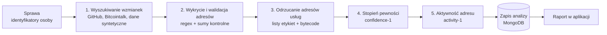

# cryptofoot (OŁCyŚ)

Narzędzie OSINT dla analityków Krajowej Administracji Skarbowej. Analityk wpisuje identyfikatory osoby (nick, login, e-mail, ID z komunikatora, adres profilu, adres portfela). Aplikacja przeszukuje publiczne źródła, wyodrębnia i weryfikuje adresy kryptowalutowe, odrzuca adresy giełd, smart kontraktów, mikserów i zbiórek, a każdemu pozostałemu adresowi wylicza **Stopień pewności** (0–100%) z jawną punktacją. Dla adresów z niezerowym Stopniem pewności odczytuje też **aktywność w sieci** (BTC, ETH) i **sygnały wyjścia do walut tradycyjnych**. Każda analiza jest zapisywana z pełnymi metadanymi, można ją powtarzać ręcznie lub cyklicznie i porównywać z poprzednią.

Zadanie konkursowe Ministerstwa Finansów na HackNation 2026 („Jak identyfikować i oceniać powiązania pomiędzy cyfrowymi śladami a adresami krypto”).

> [!IMPORTANT]
> Wynik narzędzia to **trop do dalszej weryfikacji, a nie dowód**. Powiązanie nie przesądza, że adres należy do osoby, a sygnał wyjścia do walut tradycyjnych nie jest dowodem wypłaty ani naruszenia przepisów podatkowych. Aplikacja mówi to wprost w raporcie.


## Spis treści

- [Problem i rozwiązanie](#problem-i-rozwiązanie)
- [Jak działa analiza](#jak-działa-analiza)
- [Stopień pewności (algorytm `confidence-1`)](#stopień-pewności-algorytm-confidence-1)
- [Odrzucanie błędnych przypisań](#odrzucanie-błędnych-przypisań)
- [Aktywność adresu i sygnały wyjścia do walut tradycyjnych](#aktywność-adresu-i-sygnały-wyjścia-do-walut-tradycyjnych)
- [Raport dla analityka](#raport-dla-analityka)
- [Analizy cykliczne i porównywanie wyników](#analizy-cykliczne-i-porównywanie-wyników)
- [Parametry wyszukiwania](#parametry-wyszukiwania)
- [Założenia projektu](#założenia-projektu)
- [Scenariusze testowe na danych syntetycznych](#scenariusze-testowe-na-danych-syntetycznych)
- [Uruchomienie](#uruchomienie)
- [Testy](#testy)
- [Architektura i technologie](#architektura-i-technologie)
- [Bezpieczeństwo i zgodność z zasadami OSINT](#bezpieczeństwo-i-zgodność-z-zasadami-osint)
- [Znane ograniczenia i dalszy rozwój](#znane-ograniczenia-i-dalszy-rozwój)
- [Licencje komponentów](#licencje-komponentów)

## Problem i rozwiązanie

Pracownik KAS, który szuka adresów kryptowalutowych badanej osoby, dziś ręcznie przegląda fora, profile i ogłoszenia, a potem sam łączy znaleziska i ocenia, na ile są wiarygodne. Przy szerszej analizie zajmuje to dużo czasu, jest trudne do powtórzenia i generuje wiele fałszywych tropów.

OŁCyŚ automatyzuje ten proces i oddziela od siebie dwie role: **„agent w terenie nie ocenia, analityk przy biurku nie szuka”**.

| Moduł | Pytanie | Wynik |
| --- | --- | --- |
| Dane wejściowe | Kogo badamy? | Sprawa z identyfikatorami osoby |
| Wyszukiwanie | Co znaleziono i gdzie? | Wzmianki ze źródłem, adresem URL, czasem pobrania i cytatem |
| Ocena: czyj adres | Czy to adres tej osoby? | Powiązania ze Stopniem pewności, Punktacją i Uzasadnieniem; Adresy wykluczone i odrzucone |
| Ocena: co robił adres | Czy za adresem stoją realne pieniądze? | Aktywność adresu i sygnały wyjścia do walut tradycyjnych w kolejności czasowej |
| Widok urzędnika | Co z tego wynika i skąd to wiemy? | Raport w aplikacji: rozwijana lista Powiązań, historia i porównanie analiz |

Główna zasada projektowa to **mało szumu**: nie pokazujemy informacji, które zwiększają liczbę fałszywych tropów do sprawdzenia. Interfejs jest po polsku i nie używa żargonu technicznego.

## Jak działa analiza

Jedna analiza to pięć etapów. Każdy etap to osobny moduł za interfejsem (portem), a orkiestrator nie zawiera logiki wyszukiwania ani oceny, tylko wyznacza status analizy.



1. **Wyszukiwanie** (`SearchService`) odpytuje wszystkie włączone źródła równolegle (wirtualne wątki, limit czasu na źródło). Zachowuje tylko trafne wzmianki, wycina kontekst do 200 znaków i zapisuje każdą wzmiankę z identyfikatorem SHA-256 (źródło + URL + kontekst).
2. **Przygotowanie kandydatów** (`CandidatePreparationService`, `AddressValidator`) waliduje wykryte ciągi i sprowadza adresy do postaci kanonicznej. Ten sam adres z wielu wzmianek staje się jednym kandydatem.
3. **Klasyfikacja wykluczeń** (`ExclusionClassifierService`) dzieli kandydatów na przyjętych, wykluczonych (z powodem i źródłem klasyfikacji) i niesklasyfikowanych.
4. **Ocena** (`ConfidenceScoringService`) jest czystą funkcją: te same dane zawsze dają ten sam Stopień pewności, te same reguły i ten sam tekst Uzasadnienia.
5. **Aktywność adresu** (`AddressActivityService`) sprawdza tylko Powiązania z wynikiem powyżej 0%.

Status analizy:

| Status | Kiedy |
| --- | --- |
| `Zakończona` | Wszystkie etapy przeszły, nic nie było niedostępne. Zero wzmianek ze sprawnych źródeł to też `Zakończona` („brak wyników” nie jest błędem). |
| `Częściowa` | Część źródeł, klasyfikacji lub danych z sieci była niedostępna. Reszta wyniku zostaje zachowana i oznaczona Ograniczeniami raportu. |
| `Nieudana` | Nie da się uzyskać żadnego użytecznego wyniku (wszystkie źródła niedostępne albo awaria modułu). Zapisywana w historii, nigdy nie jest pokazywana jako analiza bez znalezisk. |

Zakończona analiza nigdy się nie zmienia. Ponowne uruchomienie tworzy nową analizę, a otwarcie raportu tylko odczytuje zapisany wynik.

## Stopień pewności (algorytm `confidence-1`)

Algorytm opiera się na skali z załącznika do zadania i dodaje reguły, które ograniczają błędne przypisania. Wersja algorytmu jest zapisywana z każdą analizą.

**1. Kiedy wzmianka potwierdza adres.** Wzmianka liczy się jako potwierdzenie tylko wtedy, gdy:
- wskazuje osobę identyfikatorem zawężającym: nickiem, loginem, e-mailem, ID z komunikatora lub adresem profilu. Imię i nazwisko ani adres portfela wpisany przez analityka nie wystarczają;
- zdanie z adresem nie jest ostrzeżeniem („oszust”, „scam”, „podszywa się”, „nie wpłacaj”, „phishing” itp.);
- nie zawiera e-maila innej osoby (gdy sprawa ma e-mail, a wzmianka podaje tylko inne adresy e-mail).

Adres bez żadnej wzmianki potwierdzającej dostaje 0% i regułę „Brak powiązania z osobą”.

**2. Punkty bazowe** dają najsilniejszy rodzaj źródła wśród wzmianek potwierdzających:

| Rodzaj źródła | Jak rozpoznawany | Punkty |
| --- | --- | ---: |
| Własny profil osoby | URL pod adresem profilu ze sprawy albo strona nazwana nickiem lub loginem **i** drugi identyfikator (e-mail, ID komunikatora, imię i nazwisko) w treści. Sam nick może należeć do imiennika. | 80 |
| Ogłoszenie sprzedaży lub rozliczenie | Słowa: ogłoszenie, sprzedam, kupię, oferta, P2P, płatność, zapłata, wpłata, przelew, rozliczenie, faktura | 60 |
| Dyskusja | Pozostałe wzmianki (forum, grupa tematyczna) | 40 |
| Masowy komentarz | Słowa: giveaway, konkurs, rozdanie, airdrop, wygraj, promo | 10 |

**3. Premia za niezależne źródła: +15 pkt** (raz). Wymaga dwóch wzmianek potwierdzających z **różnych serwisów** (host), w których **zdanie z adresem jest różne**. Kolejne wzmianki z tego samego serwisu i ta sama treść skopiowana do innego serwisu nie dają premii.

**4. Reguły wyjaśniające (0 pkt)** są zapisywane, żeby analityk widział, dlaczego wynik nie jest wyższy: adres wpisany przez analityka (samo wpisanie nie jest dowodem), powiązanie tylko przez nick lub login, adres w ostrzeżeniu, e-mail innej osoby, kolejna wzmianka z tego samego serwisu, skopiowana treść, klasyfikacja niedostępna.

**5. Wynik** to suma punktów reguł, maksymalnie 100%. Przedziały w raporcie:

| Stopień pewności | Etykieta |
| --- | --- |
| 80–100% | Bardzo wysokie prawdopodobieństwo |
| 60–79% | Prawdopodobny |
| 40–59% | Średni |
| 0–39% | Niski / szum |
| – | Adres wykluczony (giełda, smart kontrakt, mikser, zbiórka): nie jest Powiązaniem |

**Przykład (scenariusz S1).** Adres ETH opublikowany na profilu `social.example/halka_eth` i niezależnie w ogłoszeniu sprzedaży roweru na `market.example`:

| Reguła (Punktacja) | Punkty |
| --- | ---: |
| Adres na profilu osoby (social.example) | 80 |
| Potwierdzenie w niezależnych źródłach (market.example, social.example) | +15 |
| **Stopień pewności** | **95%** |

Uzasadnienie generowane z szablonów reguł (bez liczb i bez modelu AI):
> Adres został opublikowany na profilu badanej osoby (social.example). Niezależne źródła różnego pochodzenia (market.example, social.example) wskazują na ten sam adres.

## Odrzucanie błędnych przypisań

Aplikacja rozróżnia dwie kategorie, które nigdy nie trafiają do Powiązań:

**Adresy odrzucone**: tekst, który wygląda jak adres, ale nie przechodzi walidacji.
- Wykrywanie: Bitcoin Base58 (`1…`, `3…`), bech32/bech32m (`bc1…`, także pisane wielkimi literami) oraz EVM (`0x` + 40 znaków hex).
- Walidacja: suma kontrolna Base58Check i wersja sieci głównej, suma kontrolna bech32/bech32m (BIP-173/BIP-350) i program świadka, suma kontrolna EIP-55 (Keccak-256) dla adresów ETH z mieszaną wielkością liter.
- Powody odrzucenia: zły format, zła suma kontrolna, nieobsługiwana sieć (np. testnet), niezgodność sieci.

**Adresy wykluczone**: poprawne adresy usług współdzielonych. Dostają 0% i nie trafiają ani do oceny, ani do analizy aktywności. Kolejność sprawdzeń:

1. **Offline'owe listy etykiet**, przy których adres nie opuszcza aplikacji. To 855 adresów ETH ze zbioru [Etherscan labels](https://github.com/brianleect/etherscan-labels): 640 giełd, portfeli powierniczych i bramek fiat, 86 mikserów, 129 zbiórek. Do tego własna lista zespołu (np. adres BTC Binance), która ma pierwszeństwo przed zbiorem. Tagi, które mogą oznaczać osobę prywatną (np. listy sankcyjne, granty Gitcoin), celowo nie są używane.
2. **Kod bajtowy (tylko ETH)**: `eth_getCode` przez publiczny węzeł JSON-RPC, z Blockchair jako źródłem zapasowym, oba bez klucza API. Kod różny od `0x` oznacza smart kontrakt. Konto z delegacją EIP-7702 (`0xef0100…`) nadal jest kontem prywatnym.
3. **Brak odpowiedzi**: kandydat jest *niesklasyfikowany*. Dostaje ocenę, ale jest oznaczony „Nie sprawdzono, czy adres należy do serwisu”, a analiza ma status `Częściowa`. Adres BTC spoza list jest przyjmowany, bo Bitcoin nie ma kodu kontraktów.

Każdy Adres wykluczony ma w raporcie powód (giełda, smart kontrakt, mikser, zbiórka), źródło klasyfikacji (np. `Etherscan labels …: Kraken 4 [kraken]`) i wzmianki, w których się pojawił.

Dodatkowe zabezpieczenia przed błędnym przypisaniem (część algorytmu oceny): adres zacytowany w ostrzeżeniu przed oszustem (S3), imiennik z innym e-mailem (S4), kopia tej samej treści (S5) i wpisy konkursowe (S7).

## Aktywność adresu i sygnały wyjścia do walut tradycyjnych

Dla każdego Powiązania z wynikiem powyżej 0% aplikacja odczytuje historię adresu i stosuje reguły `activity-1`. Wersja reguł i próg są zapisywane razem z wynikiem.


**Źródła danych** (pierwsze, które odpowie, decyduje):
1. dane syntetyczne scenariuszy demo (tylko adresy demo, oznaczone w raporcie „dane testowe”);
2. [mempool.space](https://mempool.space) dla BTC i [Blockscout](https://eth.blockscout.com) dla ETH. Oba są bez klucza API, open source i do samodzielnego hostowania. Lokalnie są wyłączone, w profilu produkcyjnym włączone.

**Co jest liczone:** łączna kwota otrzymana i wysłana, liczba transakcji, okres aktywności. Suma pochodzi wprost ze źródła albo z kompletnej historii. Jeśli historia jest niepełna, pole zostaje puste, bo **brak danych nigdy nie jest pokazywany jako zero**.

**Sygnał wyjścia do walut tradycyjnych** (trop, nie dowód):

| Rodzaj sygnału | Reguła |
| --- | --- |
| Przelew na giełdę | Wypływ na adres oznaczony jako giełda, dowolna kwota |
| Przelew na platformę P2P | Jak wyżej, z tagiem P2P (np. Remitano) |
| Przelew do bramki płatniczej | Jak wyżej, z tagiem bramki fiat (np. Bity.com) |
| Przelew do usługi karty kryptowalutowej | Jak wyżej, z tagiem karty (np. Wirex) |
| Zamiana na stablecoin | W jednej transakcji adres oddaje ETH lub inny token i otrzymuje USDT, USDC lub DAI za co najmniej **1000** jednostek. Stablecoin jest rozpoznawany po adresie kontraktu, nie po symbolu. |

Sygnały są pokazywane w kolejności czasowej, z datą, kwotą, kontrahentem (z etykietą) i linkiem do transakcji. Raport podaje też ograniczenia pokrycia: tylko ostatnie transakcje, tylko oznaczeni kontrahenci (brak sygnału nie oznacza braku wymiany), nieliczone transfery wewnętrzne, niedostępna lista transakcji. Niedostępne dane z sieci dają status `Częściowa` z ograniczeniem „dane z sieci niedostępne”, nigdy `Nieudana`.

## Raport dla analityka

Raport to rozwijana lista w aplikacji. Zwinięte Powiązanie pokazuje adres i Stopień pewności. Po rozwinięciu widać:

- **Punktacja**: reguły i ich punkty, z których da się przeliczyć wynik;
- **Uzasadnienie**: krótki tekst z szablonów reguł, bez liczb;
- **Wzmianki**: źródło, link, czas pobrania i cytowany fragment;
- **Weryfikacja adresu**: format i suma kontrolna, sieć, sprawdzenie, czy adres nie należy do znanego serwisu;
- **Aktywność adresu w sieci**: wolumen, liczba transakcji, okres, źródło danych z czasem odczytu i sygnały wyjścia do walut tradycyjnych.

Pod listą Powiązań są zwinięte sekcje **Adresy wykluczone** i **Adresy odrzucone**. Nagłówek raportu podaje rodzaj analizy (ręczna lub zaplanowana), czas startu i końca, sieci, **sprawdzone źródła** (z czasem i oznaczeniem danych testowych) oraz **Ograniczenia raportu**.

Raport rozdziela trzy rodzaje informacji, o które prosi zadanie:

| Rodzaj | Elementy raportu |
| --- | --- |
| Fakty źródłowe | Wzmianki (URL, czas pobrania, cytat), sprawdzone źródła, transakcje z identyfikatorem i linkiem |
| Wyniki obliczeń | Punktacja, Stopień pewności, Weryfikacja adresu, sumy aktywności |
| Wnioski do weryfikacji | Uzasadnienie, Powiązanie jako trop, sygnały „Możliwe wyjście do walut tradycyjnych”, Ograniczenia raportu |

**Odtwarzalność.** Każda analiza jest zapisana jako niezmienny dokument z kompletem danych: identyfikatory użyte w tej analizie, sieci, źródła (status, czas sprawdzenia, czy syntetyczne), wzmianki (źródło, URL, czas pobrania, kontekst, wykryte adresy, autor, skrót SHA-256), adresy odrzucone i wykluczone (powód, źródło klasyfikacji), Powiązania (reguły z punktami, Uzasadnienie, status klasyfikacji, aktywność ze źródłem, czasem odczytu, wersją reguł i progiem), błędy etapów, Ograniczenia raportu i wersja algorytmu. Ocena jest deterministyczna, więc z zapisanych wzmianek zawsze wynika ten sam wynik.

## Analizy cykliczne i porównywanie wyników


- **Ponowna analiza ręczna** jednym przyciskiem („Rozpocznij nową analizę”). Gdy analiza już trwa, kolejna nie startuje.
- **Harmonogram** sprawy: codziennie o 06:00 (domyślnie), co 6 godzin, co tydzień (poniedziałek 06:00) albo własny odstęp od 1 minuty do 365 dni, w strefie Europe/Warsaw. Analiza zaplanowana działa jak ręczna i nie blokuje pracy analityka. Termin, w którym poprzednia analiza jeszcze trwa, jest pomijany i odnotowywany. Terminy przegapione w czasie przestoju nie są nadrabiane. Blokada optymistyczna sprawia, że dwie instancje backendu nie uruchomią tego samego terminu dwa razy.
- **Lista spraw** z wyszukiwarką, grupami „Nowe wyniki” i „Przejrzane sprawy”, najwyższym Stopniem pewności i statusem ostatniej analizy.
- **Porównanie z poprzednią analizą** po sieci i adresie kanonicznym. Kategorie zmian: nowe powiązanie, powiązanie niezaobserwowane, zmieniony Stopień pewności, zmiana wykluczenia. „Niezaobserwowane” nie znaczy „już nie należy do osoby”: brak jest uznany za sprawdzony tylko wtedy, gdy późniejsza analiza była zakończona i ponownie sprawdziła te same źródła i sieć. Różnice w identyfikatorach, pokryciu źródeł, sieciach, wersji algorytmu lub kompletności analiz są wypisane jako ograniczenia porównania.

Dzięki temu da się wykryć **podmianę adresu portfela na profilu** w czasie (kryterium opcjonalne zadania, scenariusz S11).

## Parametry wyszukiwania

| Parametr | Wartość |
| --- | --- |
| Identyfikatory wejściowe | nick, login, e-mail, ID z komunikatora, adres profilu, adres portfela (jeden, BTC lub ETH), imię i nazwisko |
| Minimum danych | Co najmniej jeden identyfikator zawężający. Samo imię i nazwisko jest zbyt ogólne i nie uruchamia analizy. |
| Trafność wzmianki | Treść zawiera identyfikator inny niż imię i nazwisko (adres portfela porównywany w postaci kanonicznej) **albo** źródło pobrało zasób dla tego identyfikatora (autor = nick lub login, URL pod adresem profilu) |
| Kontekst wzmianki | Do 200 znaków, od 100 znaków przed trafieniem |
| Sieci | Bitcoin (P2PKH, P2SH, bech32, bech32m, sieć główna) i Ethereum |
| Limit czasu | 10 s na źródło wyszukiwania, 5 s na pojedyncze żądanie HTTP |
| **GitHub** (oficjalne REST API) | Login lub nick ze sprawy albo URL `github.com/<login>`. Pobiera profil (`name`, `bio`, `company`, `location`, `blog`) i README profilu `<login>/<login>`. Maks. 3 loginy, 256 KiB odpowiedzi, bez przekierowań. |
| **Bitcointalk** | Tylko adresy podane przez analityka: profil (`action=profile;u=<id>`, także sygnatura) albo wątek lub post. Maks. 3 zasoby i 20 postów, 2 s przerwy między żądaniami, 1 MiB odpowiedzi. Każdy post z własnym autorem, cytaty pomijane. |
| **Dane syntetyczne** | `fixtures/demo-v1.json`: 12 fikcyjnych osób, oznaczone w raporcie jako „Dane testowe” |
| Próg zamiany na stablecoin | 1000 jednostek (USDT, USDC, DAI) |
| Wersje reguł | Ocena `confidence-1`, aktywność `activity-1` |

Wszystkie limity i adresy usług można zmienić w konfiguracji (`sources.*`, `app.exclusion.*`, `app.address-activity.*`).

## Założenia projektu

- **Jeden użytkownik**: analityk KAS bez wiedzy informatycznej. Interfejs po polsku, bez żargonu.
- **Kierunek osoba → adresy.** Wpisany adres portfela jest też szukany w źródłach, ale jest daną wejściową, a nie znaleziskiem: nigdy nie jest wzmianką ani niezależnym potwierdzeniem.
- **Mało szumu i wyjaśnialność.** Każdy punkt ma regułę, każda reguła ma zdanie w Uzasadnieniu, a każde Powiązanie ma wzmianki, na których się opiera.
- **Bez AI w ścieżce decyzyjnej.** Wykrywanie adresów to wyrażenia regularne i sumy kontrolne, ocena to deterministyczne reguły. Wynik jest powtarzalny i nie zależy od modelu, a żadne dane nie trafiają do usług AI.
- **Tylko publiczne źródła i usługi bez klucza API**, bez logowania na cudze konta i bez obchodzenia zabezpieczeń.
- **Kontrolowane demo.** Prezentacja działa na fikcyjnych danych syntetycznych, więc da się ją powtórzyć. Pobieranie z prawdziwych źródeł jest sprawdzane osobno.
- **Brak danych to nie zero.** Niedostępne źródło, klasyfikacja lub dane z sieci zawsze są widoczne jako Ograniczenie raportu.

## Scenariusze testowe na danych syntetycznych

Jedenaście scenariuszy (S1–S11) z fikcyjnymi osobami w `backend/src/main/resources/fixtures/demo-v1.json`, obok pierwszej osoby demo, Zenona Fikcyjnego (`zenek_fx`). Każdy scenariusz pokazuje jedno zachowanie narzędzia: poprawny wynik, ochronę przed fałszywym tropem, znane ograniczenie, przypadek brzegowy albo zmianę między analizami. Adresy osób powstały z publicznych ziaren, więc nikt nie ma do nich kluczy. Adresy usług w S2 to prawdziwe adresy z list etykiet, bo właśnie je rozpoznają reguły wykluczeń. Dane z sieci pochodzą z `fixtures/demo-v1-activity.json`. Wszystkie wyniki są zamrożone w `DemoScenariosSpec`.

**Jak uruchomić:** *Nowa sprawa* → wpisz tylko podane pola → *Rozpocznij analizę* → w *Szczegółach sprawy* rozwiń Powiązania i sprawdź Punktację, Uzasadnienie, Wzmianki, Aktywność adresu oraz sekcje Adresów wykluczonych i odrzuconych.

| # | Wpisz | Oczekiwany wynik | Co pokazuje |
| --- | --- | --- | --- |
| S1 | Nick `halka_eth`, e-mail `halina.przykladowa@example.com`, adres profilu `https://social.example/halka_eth` | ETH `0xe73a…20c6` **95%**; 4 sygnały: zamiana na 30 000 USDC, bramka płatnicza 12 000 USDC (Bity.com), P2P 1,5 ETH (Remitano), giełda 15 000 USDC (Kraken 4) | Pełna ścieżka od śladu Web2 do sygnałów wyjścia do walut tradycyjnych |
| S2 | Nick `bogdan_platnosci` | **0 Powiązań**, **5 Adresów wykluczonych**: Binance (BTC), Kraken 4, router Uniswap (smart kontrakt), Tornado Cash (mikser), zbiórka | Osoba publikująca tylko adresy usług nie dostaje Powiązania |
| S3 | Nick `celina_uczciwa`, adres profilu `https://social.example/celina_uczciwa` | Własny adres **80%**, adres oszusta zacytowany w ostrzeżeniu **0%** | Adres z ostrzeżenia nie jest dowodem |
| S4 | Nick `darek_mazur`, e-mail `dariusz.mazur@example.com` | Ogłoszenie P2P **60%** z przelewem 0,8 BTC na Binance; adres imiennika (inny e-mail) **0%** | Ten sam nick, inna osoba |
| S5 | Nick `ewa_kopiowana` | **60%** bez premii +15; aktywność 0 BTC i 0 transakcji | Kopia nie jest niezależnym źródłem; prawdziwe zero to nie brak danych |
| S6 | Nick `franek_literowka` | **0 Powiązań**, **2 Adresy odrzucone** (BTC i ETH ze złą sumą kontrolną) | Walidacja odrzuca adresy, które tylko wyglądają poprawnie |
| S7 | Nick `grazka_konkursy` | **10%** (Niski / szum); aktywność „Nie udało się pobrać danych” | Słaby ślad zostaje nisko; brak danych nie jest zerem |
| S8 | Nick `henio_ukryty` | **0 Powiązań**, choć osoba opublikowała dwa adresy | Znane ograniczenie: adres rozbity spacjami i adres poza oknem kontekstu |
| S9 | Nick `irena_hodl`, e-mail `irena.hodl@example.com`, adres profilu `https://social.example/irena_hodl` | **80%**; 4 BTC przyjęte, 3,9 BTC wysłane, **brak sygnału** | Wpłata na nieoznaczoną giełdę nie jest rozpoznawana |
| S10 | Nick `kamil_nieobecny` | Brak wzmianek i Powiązań, źródło sprawdzone, analiza nie jest nieudana | „Brak wyników” to nie błąd |
| S11 | Nick `oliwer_zmienny`, adres profilu `https://social.example/oliwer_zmienny` | Analizy 1, 3, …: 40% i 60%. Analizy 2, 4, …: 95% i nowy adres 80% (przelew 0,35 BTC na Binance), ogłoszenie znika. **Zmiany od poprzedniej analizy (3)** | Ponowna lub zaplanowana analiza i porównanie zmian w czasie |

Każda kolejna analiza S11 przełącza fikcyjną sieć między dwoma stanami, więc porównanie zawsze ma zmiany do pokazania, także po próbach przed prezentacją.

> [!NOTE]
> Lokalnie każda analiza zawiera też źródło `synthetic-broken`, które zawsze jest niedostępne (scena „źródło niedostępne”), więc status to `Częściowa`. W produkcji to źródło jest wyłączone.

**Mapowanie na obowiązkowy scenariusz prezentacji (pkt 6 zadania):**

| Etap | Gdzie w aplikacji | Scenariusz |
| --- | --- | --- |
| Wprowadzenie danych wejściowych | Formularz *Nowa sprawa* z walidacją | S1 |
| Wyszukanie śladów OSINT | *Sprawdzone źródła*, *Wzmianki* | S1, S10 |
| Wykrycie i weryfikacja adresu | *Weryfikacja adresu*, *Adresy odrzucone* | S1, S6 |
| Wyliczenie Wskaźnika Pewności | *Stopień pewności*, *Punktacja*, *Uzasadnienie* | S1, S5, S7 |
| Odrzucenie błędnych przypisań | *Adresy wykluczone*, reguły 0 pkt | S2, S3, S4 |
| Analiza aktywności blockchain | *Aktywność adresu w sieci* | S1, S4, S9 |
| Źródła i wynik końcowy | Raport, historia analiz, porównanie | S1, S11 |

## Uruchomienie

### Wymagania

- Docker (MongoDB i backend; także testy integracyjne przez Testcontainers)
- Node.js >= 22.18 i npm >= 11.13
- Java 25, tylko do uruchamiania backendu z IDE i testów poza Dockerem
- Na Windows uruchamiaj skrypty `scripts/*.sh` w Git Bash

### Szybki start (dane demo)

```bash
git clone https://github.com/NononotaaSquad/cryptofoot.git
cd cryptofoot
(cd frontend && npm install)
./scripts/run-all.sh
```

`run-all.sh` uruchamia MongoDB i backend w Dockerze (profil `local`), czeka, aż będą zdrowe, i startuje frontend.

- Aplikacja: http://localhost:3000
- API: http://localhost:8080/api/1/…, kontrakt OpenAPI: http://localhost:8080/v3/api-docs
- Zdrowie: http://localhost:8080/actuator/health

Profil `local` działa offline na danych syntetycznych (GitHub i Bitcointalk wyłączone), sprawdza harmonogram co 5 s i udostępnia częstotliwość demo „co minutę”. Żeby pokazać ją w interfejsie, skopiuj `frontend/apps/web/.env.example` do `.env.local` i ustaw `NEXT_PUBLIC_DEMO_SCHEDULE=true`.

### Uruchomienie z prawdziwymi źródłami

```bash
docker compose -f backend/docker-compose.yaml up -d mongodb
cd backend
MONGODB_URI=mongodb://localhost:27017/db ADDRESS_ACTIVITY_LIVE_ENABLED=true ./gradlew bootRun
```

Bez profilu `local` GitHub i Bitcointalk są włączone. Token GitHub jest opcjonalny: podnosi limit API z 60 do 5000 zapytań na godzinę i nie potrzebuje żadnych uprawnień. W drugim terminalu: `cd frontend && npm run dev`.

### Konfiguracja

| Zmienna | Domyślnie | Znaczenie |
| --- | --- | --- |
| `MONGODB_URI` | brak (wymagana) | Połączenie z MongoDB |
| `SOURCES_GITHUB_ENABLED` | `true` (`local`: `false`) | Źródło GitHub |
| `SOURCES_GITHUB_TOKEN` | pusty | Token bez uprawnień; w profilu `prod` wymagany, gdy źródło jest włączone |
| `SOURCES_BITCOINTALK_ENABLED` | `true` (`local`: `false`) | Źródło Bitcointalk |
| `SOURCES_SYNTHETIC_ENABLED` | `true` | Dane syntetyczne scenariuszy demo |
| `SOURCES_SYNTHETIC_BROKEN_ENABLED` | `true` (prod: `false`) | Zawsze niedostępne źródło demo |
| `EXCLUSION_ONCHAIN_CHECK_ENABLED` | `true` | Sprawdzanie kodu bajtowego ETH w publicznych usługach |
| `ADDRESS_ACTIVITY_LIVE_ENABLED` | `false` (`prod`: `true`) | Aktywność adresu z mempool.space i Blockscout |
| `NEXT_PUBLIC_API_URL` | `http://localhost:8080` | Adres backendu dla przeglądarki, wstawiany przy `next build` |
| `NEXT_PUBLIC_DEMO_SCHEDULE` | wyłączone | Częstotliwość demo w interfejsie |

### Wdrożenie

Każdy push do `master` uruchamia `.github/workflows/ci.yml`: testy i budowanie obrazów, a potem wdrożenie backendu i frontendu do Google Cloud Run (MongoDB Atlas, token GitHub z Secret Managera). Backend działa z `--min-instances 1 --no-cpu-throttling`, żeby harmonogram uruchamiał analizy bez otwartej przeglądarki. Jednorazową konfigurację projektu GCP wykonuje `./scripts/gcp-bootstrap.sh <gcp-project-id> <region> <github-org>`.

Oba komponenty to zwykłe kontenery Docker, więc mogą działać w środowisku KAS bez publicznej chmury (patrz [dalszy rozwój](#znane-ograniczenia-i-dalszy-rozwój)).

## Testy

```bash
cd backend && ./gradlew check            # Spotless + testy jednostkowe + integracyjne (Docker)
cd frontend && npm run check             # typecheck, ESLint, Prettier, Vitest
./scripts/e2e-backend.sh                 # E2E Postman + Bruno na działającym backendzie
./scripts/api-sync.sh                    # zgodność openapi.json i wygenerowanego klienta z backendem
```

- **Backend**: ponad 50 specyfikacji Spock (jednostkowe bez kontekstu Springa oraz integracyjne z MongoDB w Testcontainers i atrapami serwerów HTTP źródeł i eksploratorów). `DemoScenariosSpec` zamraża wynik każdego scenariusza S1–S11, a `OpenApiContractSpec` pilnuje kontraktu API.
- **Frontend**: testy Vitest modeli widoków (raport, porównanie, lista spraw, harmonogram, reguły formularza).
- **E2E**: 57 żądań w identycznych kolekcjach Postman i Bruno (`.e2e/backend/`). Obejmują walidację i tworzenie spraw, analizę demo z raportem, ponowną analizę, historię i porównanie, przypadki brzegowe, harmonogram, błędy API i CORS.
- **CI** (GitHub Actions) przy każdym pull requeście i pushu do `master` uruchamia dla zmienionej części Spotless, oba zestawy testów, kontrolę kontraktu, `npm run check` i budowanie obrazów.

## Architektura i technologie

| Warstwa | Technologie |
| --- | --- |
| Backend | Kotlin 2.3, Spring Boot 4.1 (Web MVC, Validation, Actuator), Java 25, Gradle (Kotlin DSL), jsoup, Bouncy Castle (Keccak-256), springdoc-openapi |
| Baza danych | MongoDB 8 (Spring Data MongoDB): kolekcje `cases`, `analyses`, `mentions`, `schedules` |
| Frontend | Next.js 16 (App Router), React 19, TypeScript 5, Tailwind CSS 4, shadcn/ui (Base UI), TanStack Query 5, klient API generowany przez Orval z OpenAPI, Zod, Motion |
| Testy | Spock 2.5 (Groovy 5), Testcontainers, Vitest, Postman/Newman, Bruno |
| Infrastruktura | Docker, Docker Compose, Turborepo, GitHub Actions, Google Cloud Run |

```
cryptofoot/
├── backend/                         # Spring Boot (Kotlin), pakiet squad.nononotaa.backend
│   └── src/main/kotlin/…/
│       ├── analysis/                # orkiestrator, kontrakty etapów, wyszukiwanie, detektor adresów
│       │   ├── web2/                # źródła GitHub i Bitcointalk
│       │   └── synthetic/           # źródła danych demo
│       ├── service/                 # walidacja, wykluczenia, ocena, aktywność, historia, porównanie, harmonogram
│       ├── controller/ dto/ model/ repository/ config/ exception/ util/
│       └── resources/               # konfiguracja, listy etykiet, dane syntetyczne
├── frontend/                        # monorepo Turborepo
│   ├── apps/web/                    # Next.js: features/ (new-case, case-list, case-details, analysis-report, analysis-comparison)
│   └── packages/ui/                 # wspólne komponenty shadcn/ui
├── .e2e/backend/                    # kolekcje E2E Postman i Bruno
├── .agents/context/                 # słownik, model domeny, specyfikacja biznesowa, ADR-y, diagramy PlantUML
└── scripts/                         # uruchamianie, synchronizacja API, E2E, bootstrap GCP
```

**API REST** (`/api/1`):

| Metoda | Ścieżka | Opis |
| --- | --- | --- |
| `POST` | `/cases` | Utworzenie sprawy (walidacja identyfikatorów i adresu portfela) |
| `GET` | `/cases`, `/cases/{caseId}` | Lista spraw z podsumowaniem ostatniej analizy, szczegóły sprawy |
| `POST` | `/cases/{caseId}/analyses` | Start analizy ręcznej (202; 409, gdy analiza już trwa) |
| `GET` | `/cases/{caseId}/analyses` | Historia analiz sprawy |
| `GET` | `/cases/{caseId}/comparison?earlierAnalysisId=&laterAnalysisId=` | Porównanie dwóch analiz |
| `GET`, `PUT` | `/cases/{caseId}/schedule` | Odczyt i zmiana harmonogramu |
| `GET` | `/analyses/{id}`, `/analyses/{id}/report`, `/analyses/{id}/mentions` | Analiza, raport, wzmianki |

**Punkty rozszerzeń.** Każdy etap jest za interfejsem, więc rozbudowa nie wymaga zmian w orkiestratorze:
- nowe źródło Web2 to klasa implementująca `MentionSource`; `SearchService` wykrywa ją automatycznie jako bean;
- nowy eksplorator lub własny węzeł to `AddressActivitySource` albo `ContractCodeSource`;
- nowa sieć to wartość w `Network`, gałąź w `AddressValidator` i wzorzec w `AddressCandidateDetector`;
- zmiana reguł oceny lub aktywności to nowa wersja (`confidence-2`, `activity-2`); stare analizy zachowują swoją wersję, a porównanie zgłasza różnicę wersji.

Dokumentacja techniczna: [słownik pojęć](.agents/context/glossary.md), [model domeny](.agents/context/domain-model.md), [specyfikacja biznesowa](.agents/context/domain/BUSINESS-SPEC.md), [architektura backendu](.agents/context/backend/backend-architecture.md) z decyzjami w `.agents/context/backend/decisions/`, [diagramy przepływów](.agents/context/backend/diagrams/README.md), [architektura frontendu](.agents/context/frontend/frontend-architecture.md).

## Bezpieczeństwo i zgodność z zasadami OSINT

- **Tylko jawne źródła.** Oficjalne API GitHub i publiczne strony Bitcointalk. Bez logowania na cudze konta, bez obchodzenia zabezpieczeń, bez wycieków danych. Żądania mają limity rozmiaru i czasu, nie podążają za przekierowaniami, a Bitcointalk jest odpytywany z przerwami.
- **Kontrola wysyłanych danych.** Każde połączenie zewnętrzne ma własny przełącznik. Po ich wyłączeniu nic nie opuszcza aplikacji:

| Usługa | Co jest wysyłane | Przełącznik |
| --- | --- | --- |
| api.github.com | login lub nick ze sprawy | `SOURCES_GITHUB_ENABLED` |
| bitcointalk.org | URL podany przez analityka | `SOURCES_BITCOINTALK_ENABLED` |
| ethereum-rpc.publicnode.com, api.blockchair.com | adres ETH kandydata (sprawdzenie kodu) | `EXCLUSION_ONCHAIN_CHECK_ENABLED` |
| mempool.space, eth.blockscout.com | adres z Powiązania | `ADDRESS_ACTIVITY_LIVE_ENABLED` |

- **Wykluczenia offline.** Sprawdzenie list etykiet nigdy nie wysyła adresu na zewnątrz.
- **Brak usług AI i analityki.** Wyniki analiz ani dane testowe nie trafiają do żadnych innych usług. Czcionka jest dołączana do aplikacji przy budowaniu, a telemetria Next.js jest wyłączona w obrazie Docker.
- **Sekrety.** Token GitHub trafia do backendu z Secret Managera i nigdy nie jest w kodzie, obrazie ani frontendzie. Produkcja nie odpytuje GitHuba anonimowo.
- **Odporność.** Błędy API mają spójny format z polskimi komunikatami, bez szczegółów technicznych dla klienta.

> [!WARNING]
> Prototyp nie ma logowania (jeden analityk, poza zakresem hackathonu), a API dopuszcza CORS z dowolnego źródła, bo nie używa ciasteczek. Przed wdrożeniem w KAS trzeba dodać uwierzytelnianie (np. SSO resortu) i zawęzić CORS.

## Znane ograniczenia i dalszy rozwój

**Ograniczenia** (część z nich celowo pokazują scenariusze S8 i S9):
- Dwa prawdziwe źródła Web2 (GitHub, Bitcointalk). Bitcointalk działa tylko na adresach profilu lub wątku podanych przez analityka, nie po nicku.
- Adres rozbity spacjami lub poza 200-znakowym kontekstem wzmianki nie zostanie wykryty.
- Sygnały wyjścia do walut tradycyjnych rozpoznają tylko kontrahentów z list etykiet. Lista BTC jest na razie bardzo krótka.
- Eksploratory na żywo czytają pierwszą stronę historii, więc przy dużych adresach sumy pochodzą ze źródła, a sygnały tylko z ostatnich transakcji (raport to zaznacza).
- Raport jest dostępny w aplikacji. Wydruk i eksport PDF są poza zakresem.
- Numer sprawy w formacie `2026/0006` jest przygotowany w interfejsie, ale backend jeszcze go nie nadaje.
- Oznaczenie „Przejrzana” jest zapisywane w przeglądarce analityka, nie na serwerze.

**Dalszy rozwój:**
- Kolejne źródła (portale P2P, ogłoszenia, archiwa stron) jako nowe implementacje `MentionSource`.
- Własne instancje mempool.space, Blockscout i węzła Ethereum w sieci KAS zamiast usług publicznych (wystarczy zmienić adresy w konfiguracji).
- Rozbudowa list etykiet BTC i włączenie etykiet z eksploratorów.
- Eksport raportu, uwierzytelnianie i role użytkowników.
- Opcjonalne wsparcie AI przy wyodrębnianiu adresów z nietypowych tekstów, za portem `CandidatePreparation`, z lokalnym modelem. Wynik nadal musiałby przejść walidację sum kontrolnych i reguły oceny.

## Licencje komponentów

Projekt korzysta wyłącznie z komponentów open source.

<details>
<summary>Backend</summary>

| Komponent | Licencja |
| --- | --- |
| Spring Boot, Spring Framework, Spring Data MongoDB | Apache-2.0 |
| Kotlin, kotlin-reflect | Apache-2.0 |
| Jackson (jackson-module-kotlin) | Apache-2.0 |
| Hibernate Validator | Apache-2.0 |
| springdoc-openapi | Apache-2.0 |
| MongoDB Java Driver | Apache-2.0 |
| jsoup | MIT |
| Bouncy Castle (bcprov) | Bouncy Castle Licence (MIT) |
| Spock Framework, Apache Groovy | Apache-2.0 |
| Testcontainers | MIT |
| JUnit Platform | EPL-2.0 |
| Spotless | Apache-2.0 |
| ktlint | MIT |
| Gradle | Apache-2.0 |

</details>

<details>
<summary>Frontend</summary>

| Komponent | Licencja |
| --- | --- |
| Next.js, React, React DOM | MIT |
| TypeScript | Apache-2.0 |
| Tailwind CSS, tw-animate-css | MIT |
| shadcn/ui, Base UI (`@base-ui/react`) | MIT |
| class-variance-authority | Apache-2.0 |
| TanStack Query | MIT |
| Orval | MIT |
| Zod, react-hook-form | MIT |
| Motion, next-themes, Sonner | MIT |
| lucide-react | ISC |
| cmdk, embla-carousel-react, input-otp, react-day-picker, react-resizable-panels, recharts | MIT |
| Vitest, Vite | MIT |
| ESLint, typescript-eslint, Prettier, prettier-plugin-tailwindcss | MIT |
| Turborepo, husky | MIT |
| Open Sans (czcionka) | SIL Open Font License 1.1 |

</details>

<details>
<summary>Obrazy, narzędzia i dane</summary>

| Komponent | Licencja |
| --- | --- |
| MongoDB Community Server (`mongo:8`) | SSPL-1.0 |
| Eclipse Temurin (`eclipse-temurin:25`) | GPL-2.0 z Classpath Exception |
| Node.js (`node:22-slim`) | MIT |
| Newman (Postman CLI) | Apache-2.0 |
| Bruno CLI | MIT |
| Zbiór [brianleect/etherscan-labels](https://github.com/brianleect/etherscan-labels) (`backend/src/main/resources/exclusion-labels/etherscan-labels.json`) | MIT, licencja w `etherscan-labels.LICENSE` |
| Dane scenariuszy demo (`fixtures/`) | Dane własne, w pełni fikcyjne |

Znak KAS w nagłówku interfejsu należy do Krajowej Administracji Skarbowej i jest użyty wyłącznie w prototypie przygotowanym dla organizatora zadania.

</details>

## Kod przygotowany przed hackathonem

Przed startem HackNation 2026 (21.11.2026, 11:00) istniał tylko szablon repozytorium:
- szkielet backendu Spring Boot Kotlin + MongoDB (obsługa błędów, wersjonowanie API, Docker);
- monorepo frontendu Next.js ze wspólnym pakietem UI shadcn, konfiguracją generatora klienta API i powłoką aplikacji;
- dokumentacja, reguły i skille dla agentów w `.agents/` oraz CI.

Cała logika domenowa OŁCyŚ powstała w trakcie wydarzenia, co widać w historii git.
