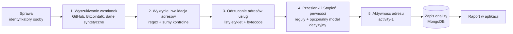

# cryptofoot (OŁCyŚ)

Osintowy Łapacz Cyfrowych Śladów to narzędzie OSINT dla analityków Krajowej Administracji Skarbowej, przygotowane na zadanie Ministerstwa Finansów w HackNation 2026. Analityk wpisuje identyfikatory osoby: nick, login, e-mail, ID z komunikatora, adres profilu lub adres portfela. Aplikacja:

- przeszukuje publiczne źródła, wyodrębnia adresy BTC i ETH i sprawdza ich sumy kontrolne;
- odrzuca adresy giełd, smart kontraktów, mikserów i zbiórek;
- liczy **Stopień pewności** (0–100%) według jawnej punktacji. Opcjonalny **model decyzyjny** pomaga odczytać sens wpisu, ale punkty zawsze przyznają reguły;
- pokazuje **aktywność adresu** i **sygnały wyjścia do walut tradycyjnych**;
- zapisuje każdą analizę z metadanymi, powtarza ją ręcznie lub według harmonogramu i porównuje z poprzednią.

> [!IMPORTANT]
> Wynik to **trop do weryfikacji, a nie dowód**. Powiązanie nie przesądza, że adres należy do osoby, a sygnał wyjścia do walut tradycyjnych nie dowodzi wypłaty ani naruszenia przepisów. Aplikacja mówi to wprost w raporcie.


## Jak działa analiza



Każdy etap to osobny moduł za interfejsem. Orkiestrator nie zawiera logiki wyszukiwania ani oceny, tylko wyznacza status analizy:
- **Zakończona**: wszystkie etapy przeszły. Także wtedy, gdy nic nie znaleziono, bo brak wyników to nie błąd.
- **Częściowa**: część źródeł lub danych była niedostępna. Reszta wyniku zostaje i ma Ograniczenia raportu.
- **Nieudana**: nie ma żadnego użytecznego wyniku.

Zakończona analiza nigdy się nie zmienia. Ponowne uruchomienie tworzy nową analizę.

## Stopień pewności

**Przesłanka** to jedno wystąpienie adresu we wzmiance, z oknem tekstu do 1200 znaków.

**Kod** ustala, czy przesłanka łączy adres z osobą. Wystarczy jeden z warunków:
- autorem wpisu jest badana osoba;
- wpis leży pod adresem jej profilu;
- identyfikator zawężający stoi najwyżej 200 znaków od adresu i jest dopasowany jako całe słowo. Imię i nazwisko się tu nie liczy.

Przesłanka ma jeden z trzech statusów:
- **zaliczona**;
- **do weryfikacji**, najwyżej 40 pkt;
- **odrzucona**: brak powiązania, e-mail innej osoby, ostrzeżenie przed adresem albo adres podany jako własny przez kogoś innego.

| Rodzaj przesłanki | Punkty |
| --- | ---: |
| Własny profil: URL pod profilem ze sprawy albo strona z nickiem i drugim identyfikatorem | 80 |
| Własna deklaracja autora| 80 |
| Ogłoszenie sprzedaży lub rozliczenie | 60 |
| Dyskusja | 40 |
| Komentarz masowy (giveaway, konkurs, airdrop) | 10 |

- **Premia +15** (raz) za drugą przesłankę, co najmniej dyskusję, z innego serwisu i z innym zdaniem. Kopie, ten sam serwis i komentarze masowe premii nie dają.
- **Limit 59%** dla adresu niesklasyfikowanego, bo może należeć do giełdy albo kontraktu.
- **Reguły 0 pkt** wyjaśniają, czemu wynik nie jest wyższy, np. „tylko nick”, „ostrzeżenie”, „kopia”.
- **Przedziały**: 80–100 bardzo wysokie prawdopodobieństwo, 60–79 prawdopodobny, 40–59 średni, 0–39 niski / szum.

**Przykład: S1 (dane fikcyjne).** Ten sam adres ETH pojawia się w dwóch wzmiankach:
- profil `halka_eth`: „Tu publikuję mój portfel ETH: 0xE73A…”. To własny profil, więc **80 pkt**;
- ogłoszenie `oferta/451`: „halka_eth sprzedaje rower szosowy. Płatność w ETH na 0xE73A…”. Inny serwis i inne zdanie, więc **+15**.

Wynik to **95%**. Punkty się nie sumują: ogłoszenie dodaje tylko premię za niezależne źródło. Uzasadnienie jest złożone z szablonów reguł, bez liczb:
> Adres został opublikowany na profilu badanej osoby (social.example). Niezależne źródła różnego pochodzenia (market.example, social.example) wskazują na ten sam adres.

### Model decyzyjny (AI)

Reguły z modelem (`confidence-3`) działają wtedy, gdy `ASSESSMENT_MODEL_API_KEY` jest ustawiony oraz `ASSESSMENT_MODEL_ENABLED` jest ustawione na `true`

Model odpowiada prawdopodobieństwami na trzy pytania:
1. Jaki to rodzaj wpisu?
2. Czy autor podaje adres jako swój?
3. Czy tekst ostrzega przed adresem?

Próg „tak” to co najmniej 0,7, próg „nie” najwyżej 0,3. Odpowiedź pomiędzy jest „niepewna” i kieruje przesłankę do weryfikacji. Dzięki temu komentarz obcej osoby na profilu („mój adres na napiwki”) zostaje odrzucony, a wpis „nie wysyłajcie na stary adres, mój nowy to …” liczy się jako własna deklaracja.

- **Pomocniczo.** Model nie łączy adresu z osobą, nie przyznaje punktów i nie pisze Uzasadnienia.
- **Odtwarzalnie.** Analiza zapisuje odpowiedzi modelu, jego wersję i wersję zestawu pytań. Raport pokazuje przy każdej przesłance, czy oceniła ją reguła, czy model. Gdy model nie odpowie w 5 s (bez ponowień), ocenę przejmują reguły, a raport dostaje Ograniczenie.
- **Prywatnie.** Model dostaje tylko okno tekstu, oceniany adres i kilka faktów. E-mail, ID komunikatora oraz imię i nazwisko są zamaskowane. URL i dane sprawy nie są wysyłane.
- **Wymiennie.** Model działa za portem `PremiseAssessment` (Spring AI `DecisionModel`), a adres serwera i nazwa modelu są w konfiguracji. Można więc podłączyć lokalny serwer.

## Odrzucanie błędnych przypisań

- **Adresy odrzucone** wyglądają jak adres, ale mają zły format, sumę kontrolną (Base58Check, bech32/bech32m, EIP-55) albo sieć, np. testnet.
- **Adresy wykluczone** dostają 0% z powodem i źródłem klasyfikacji. Sprawdzenia idą w tej kolejności:
  1. **Listy etykiet offline**: 855 adresów ETH ze zbioru Etherscan labels (giełdy, portfele powiernicze, bramki fiat, miksery, zbiórki) i własna lista zespołu. Adres nie opuszcza aplikacji.
  2. **Kod bajtowy ETH**: `eth_getCode`, z Blockchair jako zapasem. Kod inny niż `0x` oznacza smart kontrakt. Konto z delegacją EIP-7702 zostaje kontem prywatnym.
  3. **Brak odpowiedzi**: adres jest niesklasyfikowany, oznaczony w raporcie i ograniczony do 59%.

## Aktywność adresu i sygnały wyjścia do walut tradycyjnych


Dla Powiązań powyżej 0% raport pokazuje:
- sumę otrzymaną i wysłaną;
- liczbę transakcji i okres aktywności;
- sygnały wyjścia do walut tradycyjnych w kolejności czasowej (reguły `activity-1`).

Dane pochodzą z mempool.space (BTC) i Blockscout (ETH). Obie usługi działają bez klucza API i można je hostować samodzielnie. **Brak danych nigdy nie jest pokazywany jako zero.**

| Sygnał | Reguła |
| --- | --- |
| Przelew na giełdę, platformę P2P, bramkę płatniczą lub usługę karty | Wypływ na adres z listy etykiet, dowolna kwota. Rodzaj wynika z tagu, np. Remitano, Bity.com, Wirex. |
| Zamiana na stablecoin | W jednej transakcji adres oddaje ETH lub token i dostaje co najmniej 1000 USDT, USDC lub DAI. Stablecoin rozpoznaje się po adresie kontraktu. |

Sygnał to trop, nie dowód. Raport podaje ograniczenia pokrycia, np. że wykrywane są tylko serwisy z list etykiet.

## Raport dla analityka

Raport to rozwijana lista Powiązań. Po rozwinięciu Powiązania widać:
- **Punktację**: reguły, punkty i przesłanki, które je uruchomiły;
- **Uzasadnienie**;
- **Przesłanki**: status, „Oceniono: reguła” lub „Oceniono: model”, odpowiedzi modelu;
- **Wzmianki**: źródło, link, czas pobrania, cytat;
- **Weryfikację adresu** i **Aktywność adresu**.

Pod listą są sekcje *Adresy wykluczone* i *Adresy odrzucone*. Nagłówek raportu podaje rodzaj analizy, czasy, sieci, tryb oceny z wersjami, sprawdzone źródła i Ograniczenia raportu.

| Rodzaj informacji | Elementy raportu |
| --- | --- |
| Fakty źródłowe | Wzmianki, sprawdzone źródła, transakcje |
| Wyniki obliczeń | Punktacja, Stopień pewności, Weryfikacja adresu, sumy aktywności, odpowiedzi modelu |
| Wnioski do weryfikacji | Uzasadnienie, przesłanki do weryfikacji, sygnały wyjścia, Ograniczenia raportu |

Każda analiza to niezmienny dokument w bazie. Zawiera:
- użyte identyfikatory i źródła ze statusem i czasem sprawdzenia;
- wzmianki z pełną treścią i skrótem SHA-256;
- przesłanki z faktami i odpowiedziami modelu, reguły z punktami;
- aktywność ze źródłem i czasem odczytu;
- wersje algorytmu, modelu i reguł.

Dzięki temu każdą analizę da się odtworzyć i zweryfikować.

## Analizy cykliczne i porównanie


- **Ponowna analiza** startuje jednym przyciskiem albo według **harmonogramu**: codziennie o 06:00, co 6 godzin, co tydzień lub w odstępie od 1 minuty do 365 dni (strefa Europe/Warsaw). Termin, w którym poprzednia analiza jeszcze trwa, jest pomijany. Terminy przegapione w czasie przestoju nie są nadrabiane.
- **Porównanie z poprzednią analizą** pokazuje nowe powiązania, niezaobserwowane powiązania, zmiany Stopnia pewności i zmiany wykluczenia.
  - Zmiana przy tych samych wzmiankach jest oznaczana jako zmiana oceny modelu.
  - Różnice w źródłach, sieciach i wersjach są wypisane jako ograniczenia porównania.
- Pozwala to wykryć **podmianę adresu portfela na profilu** (kryterium opcjonalne zadania, scenariusz S11).

## Parametry wyszukiwania

| Parametr | Wartość |
| --- | --- |
| Dane wejściowe | Nick, login, e-mail, ID komunikatora, adres profilu, adres portfela (BTC lub ETH), imię i nazwisko. Wymagany co najmniej jeden identyfikator zawężający, samo imię i nazwisko nie wystarcza. |
| Trafność wzmianki | Treść zawiera identyfikator inny niż imię i nazwisko albo źródło pobrało zasób dla tego identyfikatora |
| Sieci | Bitcoin (P2PKH, P2SH, bech32, bech32m) i Ethereum |
| Okna tekstu | Fragment dla analityka: 200 znaków. Okno przesłanki: 1200 znaków. Powiązanie przez identyfikator: do 200 znaków od adresu. |
| GitHub (REST API) | Login, nick lub URL profilu; pobiera profil i README profilu; maks. 3 loginy |
| Bitcointalk | Tylko URL profilu, wątku lub posta podany przez analityka; maks. 3 zasoby, 20 postów, 2 s przerwy między żądaniami |
| Dane syntetyczne | `fixtures/demo-v1.json`, w raporcie oznaczone jako „Dane testowe” |
| Limity czasu | 10 s na źródło, 5 s na żądanie HTTP i na odpowiedź modelu |
| Model decyzyjny | Zestaw pytań `premise-questions-1`, progi 0,7 / 0,3 (rodzaj wpisu 0,5) |
| Próg zamiany na stablecoin | 1000 |

## Założenia

- Analityk KAS. Interfejs jest po polsku.
- Kierunek osoba → adresy. Wpisany adres portfela to dana wejściowa, nigdy dowód.
- Mało szumu i wyjaśnialność: każdy punkt ma regułę, zdanie w Uzasadnieniu i swoje przesłanki.
- Model decyzyjny wspomaga, reguły decydują. Bez klucza aplikacja działa w całości na regułach.
- Tylko publiczne źródła, bez logowania na cudze konta. Każde połączenie zewnętrzne da się wyłączyć.
- Demo działa na fikcyjnych danych syntetycznych, więc można je powtórzyć.
- Brak danych to nie zero. Niedostępne źródło zawsze jest Ograniczeniem raportu.

## Scenariusze testowe (dane syntetyczne)

W `backend/src/main/resources/fixtures/demo-v1.json` jest 11 fikcyjnych osób. Ich wyniki w trybie „tylko reguły” są zamrożone w `DemoScenariosSpec`. Aby sprawdzić scenariusz: *Nowa sprawa* → wpisz podane pola → *Rozpocznij analizę* → rozwiń Powiązania.

| # | Wpisz | Wynik | Co pokazuje |
| --- | --- | --- | --- |
| S1 | Nick `halka_eth`, e-mail `halina.przykladowa@example.com`, profil `https://social.example/halka_eth` | 95%; 4 sygnały wyjścia (stablecoin, bramka, P2P, giełda) | Pełna ścieżka |
| S2 | Nick `bogdan_platnosci` | 0 Powiązań, 5 Adresów wykluczonych | Adresy usług nie są przypisywane |
| S3 | Nick `celina_uczciwa`, profil `https://social.example/celina_uczciwa` | 80%; adres oszusta z ostrzeżenia 0% | Ostrzeżenie nie jest dowodem |
| S4 | Nick `darek_mazur`, e-mail `dariusz.mazur@example.com` | 60% z przelewem na Binance; imiennik 0% | Ten sam nick, inna osoba |
| S5 | Nick `ewa_kopiowana` | 60% bez premii; aktywność 0 BTC | Kopia nie jest niezależna; prawdziwe zero to nie brak danych |
| S6 | Nick `franek_literowka` | 2 Adresy odrzucone | Zła suma kontrolna |
| S7 | Nick `grazka_konkursy` | 10%; aktywność niedostępna | Słaby ślad; brak danych to nie zero |
| S8 | Nick `henio_ukryty` | Adres rozbity spacjami pominięty; adres daleko od nicku 0% | Znane ograniczenia |
| S9 | Nick `irena_hodl`, e-mail `irena.hodl@example.com`, profil `https://social.example/irena_hodl` | 80%; brak sygnału | Giełda spoza list nie jest rozpoznana |
| S10 | Nick `kamil_nieobecny` | Brak wzmianek, analiza udana | „Brak wyników” to nie błąd |
| S11 | Nick `oliwer_zmienny`, profil `https://social.example/oliwer_zmienny` | Każda kolejna analiza zmienia wynik; „Zmiany od poprzedniej analizy (3)” | Porównanie w czasie |

Lokalnie dochodzi źródło `synthetic-broken`, które zawsze jest niedostępne, więc status analizy to „Częściowa”.

## Uruchomienie

Wymagania: Docker oraz Node.js ≥ 22.18 z npm ≥ 11.13. Java 25 jest potrzebna tylko do testów i uruchamiania z IDE. Na Windows skrypty działają w Git Bash.

```bash
git clone https://github.com/NononotaaSquad/cryptofoot.git
cd cryptofoot
(cd frontend && npm install)
./scripts/run-all.sh        # MongoDB i backend w Dockerze (profil local) + frontend
```

- Aplikacja: http://localhost:3000
- API: http://localhost:8080/api/1
- OpenAPI: http://localhost:8080/v3/api-docs

Profil `local` działa offline, na danych demo. Prawdziwe źródła działają bez tego profilu:
1. `docker compose -f backend/docker-compose.yaml up -d mongodb`
2. W katalogu `backend/`: `MONGODB_URI=mongodb://localhost:27017/db ./gradlew bootRun`

| Zmienna | Domyślnie | Znaczenie |
| --- | --- | --- |
| `MONGODB_URI` | wymagana | Połączenie z MongoDB |
| `ASSESSMENT_MODEL_API_KEY` | pusty | Klucz modelu decyzyjnego; bez niego działają tylko reguły. Docker Compose czyta go też z `backend/.env`. |
| `ASSESSMENT_MODEL_ENABLED` | `true` | Wyłącznik modelu |
| `SOURCES_GITHUB_ENABLED`, `SOURCES_BITCOINTALK_ENABLED` | `true` (`local`: `false`) | Źródła Web2 |
| `SOURCES_GITHUB_TOKEN` | pusty | Token bez uprawnień; wymagany w profilu `prod` |
| `EXCLUSION_ONCHAIN_CHECK_ENABLED` | `true` | Sprawdzanie kodu bajtowego ETH |
| `ADDRESS_ACTIVITY_LIVE_ENABLED` | `false` (`prod`: `true`) | Aktywność z mempool.space i Blockscout |
| `SOURCES_SYNTHETIC_ENABLED`, `SOURCES_SYNTHETIC_BROKEN_ENABLED` | `true` (`prod`: drugi `false`) | Dane demo |
| `NEXT_PUBLIC_API_URL` | `http://localhost:8080` | Adres backendu, ustalany przy `next build` |

**Wdrożenie:** push do `master` uruchamia GitHub Actions, które wdrażają backend i frontend na Google Cloud Run (baza: MongoDB Atlas). Oba komponenty to kontenery Docker, więc mogą działać w KAS bez publicznej chmury.

## Testy

```bash
cd backend && ./gradlew check     # Spotless + testy Spock (jednostkowe i integracyjne z Testcontainers)
cd frontend && npm run check      # typecheck, ESLint, Prettier, Vitest
./scripts/e2e-backend.sh          # E2E Postman + Bruno (57 żądań)
./scripts/api-sync.sh             # zgodność kontraktu OpenAPI z klientem
```

Testy obejmują między innymi zamrożone scenariusze S1–S11, zbiór wzorcowy w trzech wersjach algorytmu i kontrakt API. CI uruchamia je przy pull requestach i pushu do `master`.

## Architektura

| Warstwa | Technologie |
| --- | --- |
| Backend | Kotlin 2.3, Spring Boot 4.2, Java 25, Spring Data MongoDB, jsoup, Bouncy Castle, springdoc-openapi |
| AI | Spring AI 2.1 (`DecisionModel`) z opcjonalnym modelem decyzyjnym |
| Baza danych | MongoDB 8 |
| Frontend | Next.js 16, React 19, TypeScript 5, Tailwind CSS 4, shadcn/ui, TanStack Query, klient API generowany przez Orval |
| Testy i infrastruktura | Spock, Testcontainers, Vitest, Postman, Bruno, Docker, Turborepo, GitHub Actions |

Każdy etap analizy działa za interfejsem, więc rozbudowa nie zmienia orkiestratora:
- nowe źródło to implementacja `MentionSource`;
- nowy eksplorator to `AddressActivitySource`;
- inny model to `PremiseAssessment` albo zmiana adresu w konfiguracji;
- nowa sieć to wartość w `Network` i nowa gałąź walidatora.

Zmiana reguł to nowa wersja algorytmu, a stare analizy zachowują swoją.

**API** (`/api/1`):

| Zasób | Endpointy |
| --- | --- |
| Sprawy | `POST`, `GET /cases`; `GET /cases/{id}` |
| Analizy sprawy | `POST`, `GET /cases/{id}/analyses` |
| Porównanie | `GET /cases/{id}/comparison` |
| Harmonogram | `GET`, `PUT /cases/{id}/schedule` |
| Pojedyncza analiza | `GET /analyses/{id}`, `/analyses/{id}/report`, `/analyses/{id}/mentions` |

Dokumentacja: [słownik](.agents/context/glossary.md), [model domeny](.agents/context/domain-model.md), [specyfikacja](.agents/context/domain/BUSINESS-SPEC.md), [architektura backendu](.agents/context/backend/backend-architecture.md), [diagramy](.agents/context/backend/diagrams/README.md), [frontend](.agents/context/frontend/frontend-architecture.md).

## Bezpieczeństwo i OSINT

Aplikacja korzysta tylko z jawnych źródeł, bez logowania na cudze konta i bez obchodzenia zabezpieczeń. Żądania mają limity rozmiaru i czasu, a każde połączenie zewnętrzne ma wyłącznik:

| Usługa | Co jest wysyłane | Wyłącznik |
| --- | --- | --- |
| api.github.com | Login lub nick | `SOURCES_GITHUB_ENABLED` |
| bitcointalk.org | URL od analityka | `SOURCES_BITCOINTALK_ENABLED` |
| ethereum-rpc.publicnode.com, api.blockchair.com | Adres ETH (sprawdzenie kodu bajtowego) | `EXCLUSION_ONCHAIN_CHECK_ENABLED` |
| mempool.space, eth.blockscout.com | Adres z Powiązania | `ADDRESS_ACTIVITY_LIVE_ENABLED` |
| Usługa modelu decyzyjnego (`app.assessment.model.base-url`) | Zamaskowane okno tekstu, adres, fakty | Brak klucza albo `ASSESSMENT_MODEL_ENABLED=false` |

## Licencje komponentów

Kod korzysta wyłącznie z komponentów open source. Model decyzyjny to opcjonalna, zamknięta usługa zewnętrzna, a nie komponent repozytorium.

<details>
<summary>Lista licencji</summary>

| Komponent | Licencja |
| --- | --- |
| Spring Boot, Spring Framework, Spring Data, Spring AI, Kotlin, Jackson, Hibernate Validator, springdoc-openapi, MongoDB Java Driver, Spock, Groovy, Spotless, Gradle, Newman | Apache-2.0 |
| TypeScript, class-variance-authority | Apache-2.0 |
| jsoup, Testcontainers, ktlint, Bruno CLI, Node.js | MIT |
| Next.js, React, Tailwind CSS, shadcn/ui, Base UI, TanStack Query, Orval, Zod, react-hook-form, Motion, next-themes, Sonner, cmdk, embla-carousel-react, input-otp, react-day-picker, react-resizable-panels, recharts, tw-animate-css, Vitest, Vite, ESLint, typescript-eslint, Prettier, Turborepo, husky | MIT |
| Bouncy Castle | Bouncy Castle Licence (MIT) |
| JUnit Platform | EPL-2.0 |
| lucide-react | ISC |
| Open Sans | SIL OFL 1.1 |
| MongoDB Community Server (`mongo:8`) | SSPL-1.0 |
| Eclipse Temurin (`eclipse-temurin:25`) | GPL-2.0 z Classpath Exception |
| [brianleect/etherscan-labels](https://github.com/brianleect/etherscan-labels) | MIT (`etherscan-labels.LICENSE`) |
| Dane demo (`fixtures/`) | Własne, fikcyjne |

Znak KAS w nagłówku interfejsu należy do Krajowej Administracji Skarbowej i jest użyty wyłącznie w prototypie dla organizatora zadania.

</details>